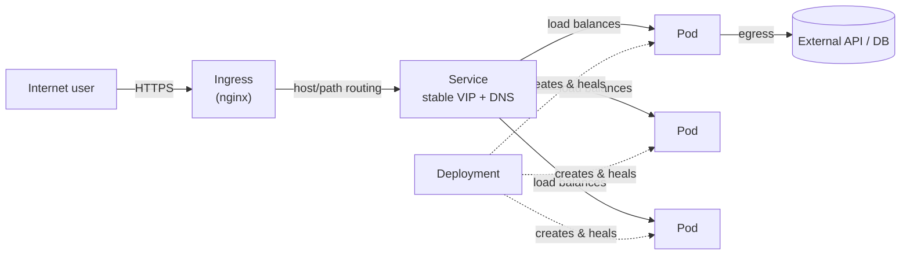

# Kubernetes Practice Lab — From Zero to a Production-like App

This folder is a **self-paced Kubernetes course**. It has two halves:

1. **Concepts** — short, ordered lessons that explain what each Kubernetes object is,
   what problem it solves, and how it fits into the life of a real request.
2. **Lab** — one realistic application ("TaskFlow") that you build up step by step, so
   every concept ends up running on a real cluster you can `kubectl describe`.

Every concept lesson links to the lab step that uses it, and every lab step links back
to the concept it exercises. Read a lesson, then go do the matching step.

---

## 1. The one-paragraph mental model

You package your application as a **container image**. Kubernetes does not run containers
directly — it wraps them in a **Pod** (the smallest deployable unit). Pods are
**ephemeral**: they get deleted, rescheduled, resized and replaced, and they get a new IP
address every time. So nobody should talk to a Pod directly.

Instead you declare *how many copies you want* using a **Deployment**, and Kubernetes
schedules those Pods onto whatever **Node** has room and keeps them alive forever
(self-healing, rolling updates, scaling). In front of the ever-changing Pods you put a
**Service**, which gives the group of Pods **one stable DNS name and IP** that never
changes, plus load balancing.

Pods that need a **stable identity and their own disk** (databases, queues) use a
**StatefulSet** instead of a Deployment. Pods that must run **once on every Node**
(log shippers, node exporters) use a **DaemonSet**. Configuration and secrets go in
**ConfigMaps** and **Secrets**, not in the image.

In production you do **not** expose the Service to the internet directly. You put an
**Ingress** in front of it: the Ingress is the single front door that terminates TLS and
routes by hostname and path to the right Service. Traffic *out* of the cluster (to
databases, third-party APIs, the internet) is **Egress**, and it is controlled with
**NetworkPolicies**.

That is the whole story. The rest of this repo is the detail.



---

## 2. Repository map

```
practic_lap/
├── sample.yaml                     # your first Pod manifest (used in lab step 03)
├── labs/                           # ready-to-apply YAML for the whole lab
│   ├── app/                        # the TaskFlow sample application + Dockerfile
│   ├── 01-namespace.yaml
│   ├── 02-config-secret.yaml
│   ├── 03-pod.yaml
│   ├── 04-deployment.yaml
│   ├── 05-service.yaml
│   ├── 06-ingress.yaml
│   ├── 07-postgres-statefulset.yaml
│   ├── 08-redis.yaml
│   ├── 09-worker-deployment.yaml
│   ├── 10-daemonset-log-agent.yaml
│   ├── 11-networkpolicies.yaml
│   ├── 12-hpa-pdb.yaml
│   └── 13-cronjob-migrate.yaml
└── docs/
    ├── README.md                   # you are here
    ├── getting-started/            # get a cluster, learn kubectl, learn the mental model
    ├── concepts/                   # one lesson per Kubernetes object
    ├── architecture/               # what actually happens end-to-end
    ├── lab/                        # guided practice, step by step
    └── reference/                  # cheatsheet, glossary, interview answers
```

---

## 3. Learning path

### Track A — Concepts (read in order)

| # | Lesson | You will be able to answer |
|---|---|---|
| — | [Mental model](getting-started/03-mental-model.md) | How do image → Pod → Deployment → Service → Ingress fit together? |
| 01 | [What is Kubernetes](concepts/01-what-is-kubernetes.md) | What problem does it solve, and what are the control plane and nodes? |
| 02 | [Pod](concepts/02-pod.md) | Why is the Pod (not the container) the unit? |
| 03 | [Deployment](concepts/03-deployment.md) | How does self-healing, scaling and rolling update work? |
| 04 | [Service](concepts/04-service.md) | How do we get a stable address in front of ephemeral Pods? |
| 05 | [Ingress](concepts/05-ingress.md) | How does the outside world reach a Service safely? |
| 06 | [Egress](concepts/06-egress.md) | How does traffic *leave* the cluster, and how do we restrict it? |
| 07 | [StatefulSet](concepts/07-statefulset.md) | What changes when a workload needs identity and storage? |
| 08 | [DaemonSet](concepts/08-daemonset.md) | How do we run one Pod on every Node? |
| 09 | [ConfigMaps & Secrets](concepts/09-configmaps-and-secrets.md) | How do we inject config without rebuilding the image? |
| 10 | [Storage & Volumes](concepts/10-storage-and-volumes.md) | How does data survive a Pod restart? |
| 11 | [Probes, Resources & Scaling](concepts/11-probes-resources-and-scaling.md) | How does Kubernetes know a Pod is healthy and how much CPU it may use? |
| 12 | [Namespaces, RBAC & Quotas](concepts/12-namespaces-rbac-and-quotas.md) | How do we isolate teams and limit what they can do? |
| 13 | [Jobs & CronJobs](concepts/13-jobs-and-cronjobs.md) | How do we run work that must finish? |

Then read the two architecture docs, which tie everything together:

- [Request lifecycle: north-south, east-west, and outbound](architecture/01-request-lifecycle.md)
- [What happens when you run `kubectl apply`](architecture/02-what-happens-on-apply.md)

### Track B — Lab (do it hands-on)

| # | Step | Practises |
|---|---|---|
| 00 | [Scenario & requirements](lab/00-scenario-and-requirements.md) | Translating a business requirement into Kubernetes objects |
| 01 | [Bootstrap the cluster](lab/01-bootstrap-cluster-and-tools.md) | Cluster, kubectl context, ingress controller, metrics-server |
| 02 | [Namespace, ConfigMap, Secret](lab/02-namespace-config-secrets.md) | Isolation, config injection |
| 03 | [Your first Pod](lab/03-pods-first-contact.md) | Pod, ephemerality, `exec`, `logs`, self-healing |
| 04 | [Deployment + image](lab/04-deployment-and-image.md) | Build image, rollout, scale, self-healing |
| 05 | [Service](lab/05-service.md) | Stable DNS, ClusterIP, port-forward, load balancing |
| 06 | [Ingress](lab/06-ingress.md) | Host-based routing, path routing, TLS-ready setup |
| 07 | [StatefulSet + Postgres](lab/07-statefulset-postgres.md) | Headless Service, PVC, stable network identity |
| 08 | [DaemonSet](lab/08-daemonset.md) | One Pod per Node, hostPath, and why privileged agents need their own namespace |
| 09 | [Egress & NetworkPolicy](lab/09-egress-and-network-policies.md) | Default-deny, DNS egress, allow-lists |
| 10 | [Probes, HPA, PDB, rollouts](lab/10-probes-scaling-and-rollouts.md) | Health, autoscaling, safe deploys |
| 11 | [Operations & troubleshooting](lab/11-operations-troubleshooting.md) | Debugging a broken deployment like a pro |
| 12 | [Job & CronJob](lab/12-job-and-cronjob.md) | Migrations, scheduled cleanup, idempotency |
| 13 | [Cleanup & review](lab/13-cleanup-and-review.md) | Tear down, self-assessment, what to learn next |

### Track C — Reference & interview prep

- [kubectl cheatsheet](reference/kubectl-cheatsheet.md)
- [Glossary](reference/glossary.md)
- [Interview questions with answers](reference/interview-questions.md)

---

## 4. Suggested schedule

| Week | Focus | Outcome |
|---|---|---|
| 1 | Read `concepts/01`–`04`, do lab steps 01–05 | An app running in a Pod, owned by a Deployment, reachable through a Service |
| 2 | Read `concepts/05`–`08`, do lab steps 06–08 | App exposed through an Ingress with a real hostname; Postgres with a PVC; a DaemonSet |
| 3 | Read `concepts/09`–`13`, do lab steps 09–10 | Config/Secrets, NetworkPolicy egress rules, probes, HPA, rolling update |
| 4 | Lab step 11–12, then `architecture/*` and `reference/interview-questions.md` | You can debug a broken workload from memory and explain every object out loud |

Roughly 1–2 hours per step. Do not read the whole `concepts/` folder first — read one
lesson, run the matching lab step, then move on. Muscle memory beats reading.

---

## 5. Prerequisites (already verified on this machine)

| Tool | Status | Notes |
|---|---|---|
| `docker` | ✅ 29.7.2 (Docker Desktop, engine running) | Builds images; Docker Desktop can also host a cluster |
| `kubectl` | ✅ v1.36.1 | Shipped with Docker Desktop |
| `minikube` | ✅ installed at `C:\minikube\minikube.exe` | No profile yet — `minikube start` creates one |
| `kind` | ❌ not installed | Optional alternative cluster |
| `helm` | ❌ not installed | Optional; the lab uses plain YAML on purpose |

**Recommended path for this lab: minikube**, because its ingress and metrics-server
add-ons are single commands and it has a clean, disposable profile. Docker Desktop
Kubernetes works too and is documented as an alternative in
[lab step 01](lab/01-bootstrap-cluster-and-tools.md).

You do **not** need a cloud account. Everything here runs on one local machine.

---

## 6. Conventions used in the lab

- **Namespace:** `taskflow` for the application. **`node-agents`** for the privileged
  DaemonSet, because `baseline` Pod Security forbids `hostPath` — see
  [lab step 08](lab/08-daemonset.md).
- **Labels:** every object gets `app.kubernetes.io/name`, `app.kubernetes.io/component`,
  `app.kubernetes.io/part-of: taskflow`. Selectors rely on these, so do not rename them.
- **Image tag:** never `latest` in the lab — we use `1.0.0`, then `1.1.0` to demo a rollout.
- **StorageClass:** not specified, so the cluster's default is used (works on both
  minikube and Docker Desktop).
- **Command blocks:** shown for **PowerShell** (this machine). Bash equivalents are noted
  where the syntax genuinely differs, e.g. `minikube docker-env`.

---

## 7. Progress checklist

Copy this into your notes and tick it off.

```
Cluster
[ ] 01 kubectl connected: kubectl get nodes shows Ready
[ ] 01 Namespace taskflow exists
[ ] 01 ingress-nginx controller Pod is Running
[ ] 01 metrics-server is serving: kubectl top nodes works

Core objects
[ ] 02 ConfigMap and Secret created and inspected
[ ] 03 Pod running; deleted it and saw it NOT come back (ephemeral!)
[ ] 04 Built taskflow-api image and rolled out a Deployment
[ ] 04 Scaled 1 -> 3 replicas and saw 3 Pods
[ ] 04 Deleted a Pod and watched the Deployment recreate it
[ ] 04 Performed a rolling update 1.0.0 -> 1.1.0 and rolled back
[ ] 05 Service reachable by DNS name from another Pod
[ ] 06 Ingress routes taskflow.local to the API

Real-world patterns
[ ] 07 Postgres StatefulSet with a PVC; data survived a Pod delete
[ ] 07 Connected to postgres-0 by its stable DNS name
[ ] 08 DaemonSet has exactly one Pod per Node (namespace node-agents)
[ ] 09 default-deny NetworkPolicy deployed; verified the API was blocked
[ ] 09 DNS egress allowed again; external call succeeded
[ ] 10 Liveness/readiness probes firing; saw a Pod fail readiness
[ ] 10 HPA scaled on CPU load
[ ] 10 PDB protected availability during a node drain
[ ] 11 Debugged a CrashLoopBackOff using logs + describe + events
[ ] 13 Ran a Job (migration) and a CronJob

Understanding
[ ] I can explain why Services exist instead of using Pod IPs
[ ] I can explain why a database is a StatefulSet and not a Deployment
[ ] I can explain what an Ingress controller actually is
[ ] I can explain why a hostPath DaemonSet cannot live in a baseline namespace
[ ] I can trace a request: DNS -> Ingress -> Service -> Pod -> container
```

---

## 8. About the practice app

**TaskFlow** is a deliberately small task-management backend, chosen because it forces
every real-world concern to appear:

- an HTTP API tier that must scale horizontally → **Deployment + Service + HPA**,
- a PostgreSQL database with data that must survive → **StatefulSet + PVC + Secret**,
- a Redis queue plus a background worker → **second Deployment, cluster-internal Service**,
- a schema migration that must run once → **Job**,
- nightly cleanup that must run on a schedule → **CronJob**,
- a node-level log/metrics agent → **DaemonSet**,
- one public hostname with TLS → **Ingress**,
- calls to a third-party API → **Egress + NetworkPolicy**.

Its source code lives in [`labs/app/`](../labs/app/) and is small enough to read in one
sitting.

---

## 9. External references worth bookmarking

- Kubernetes docs — Concepts: <https://kubernetes.io/docs/concepts/>
- `kubectl` reference: <https://kubernetes.io/docs/reference/kubectl/>
- Ingress-nginx: <https://kubernetes.github.io/ingress-nginx/>
- NetworkPolicy editor (visualise allow/deny): <https://editor.networkpolicy.io/>
- minikube handbook: <https://minikube.sigs.k8s.io/docs/>
