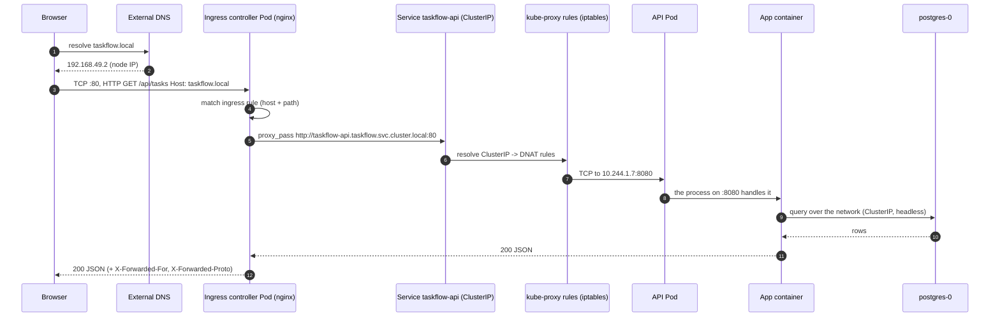

# Architecture 01 — The request lifecycle

> **Goal:** follow one HTTP request from a browser to your container and back, naming every
> component it touches. When something breaks in production, this map tells you *which layer
> to blame*.

Prerequisites: [Ingress](../concepts/05-ingress.md), [Service](../concepts/04-service.md),
[Egress](../concepts/06-egress.md).

---

## 1. The whole picture



Two HTTP hops and one TCP hop. Each hop is separately observable and separately breakable.

---

## 2. Hop by hop

### Hop 1 — DNS (outside the cluster)

`taskflow.local` → an IP. In production this is Route 53/Cloudflare pointing at a load
balancer. In this lab it is a hosts-file entry pointing at the minikube node or
`127.0.0.1` ([setup doc](../getting-started/01-local-cluster-setup.md)).

- **Fails how:** `NXDOMAIN`, or resolving to the wrong IP. Nothing inside the cluster can fix
  this.
- **Blame:** DNS provider / hosts file / TTL caching.

### Hop 2 — Node port or cloud load balancer

A `Service type: LoadBalancer` or the ingress controller's `NodePort` accepts the connection.
With `externalTrafficPolicy: Cluster`, the source IP is **SNAT'd to the Node's IP** here —
which is why your app logs the node IP unless you configure
`externalTrafficPolicy: Local` or trust `X-Forwarded-For` from the controller.

### Hop 3 — Ingress controller

The controller Pod (a normal Pod, behind a normal Service, usually with `hostNetwork` or a
host port) reads the `Host` header and the path, matches them against all `Ingress` objects
of its class, and picks a backend.

- It also terminates **TLS** here, so the certificate is served by the controller, not the app.
- It adds `X-Forwarded-For`, `X-Forwarded-Proto`, `X-Forwarded-Host`, `X-Real-IP`.
- **Fails how:** `404` (no matching rule), `503` (backend has no Ready endpoints), `502`
  (backend refused/unreachable), `504` (backend timed out).
- **Blame:** `kubectl describe ingress`, `kubectl get endpointslices`, controller logs.

### Hop 4 — Service DNS → ClusterIP

The controller resolves `taskflow-api.taskflow.svc.cluster.local` via CoreDNS and connects to
`10.96.0.42` (the ClusterIP). This is real DNS inside the cluster with the standard search
domains.

- **Fails how:** `no such host` → CoreDNS problem, wrong name, or a NetworkPolicy blocking
  DNS.
- **Blame:** the name you wrote, CoreDNS Pods, or the egress DNS rule.

### Hop 5 — kube-proxy / eBPF datapath

The ClusterIP is virtual — nothing listens on it. kube-proxy-programmed rules (iptables/IPVS)
or an eBPF datapath rewrites the destination to a real Pod IP, chosen from the Service's
**EndpointSlice** (Ready Pods only), round-robin per connection.

- This is where **load balancing** actually happens: in each client Node's kernel, not in a
  central proxy.
- **Fails how:** connection refused / timeout, or all traffic to one Pod.
- **Blame:** empty EndpointSlice (selector or readiness), wrong `targetPort`.

### Hop 6 — Pod network namespace → container

The packet arrives on the Pod's `veth`, enters the Pod's network namespace (created by the CNI
plugin) and is delivered to the container listening on `containerPort`.

- **Fails how:** connection refused → the app is not listening, or is bound to `127.0.0.1`
  instead of `0.0.0.0`, or listening on a different port than `targetPort`.
- **Blame:** the app's bind address/port, or a wrong `targetPort`.

### Hop 7 — The application

Probes are already involved here: the Pod only receives traffic because its **readinessProbe**
is passing. If the probe endpoint is broken, the Pod is silently removed from the endpoints and
you get 503s that look like "the Service is down".

- **Blame:** your code, its config (ConfigMap/Secret), and the readiness endpoint.

### Hop 8 — East-west from the app to Postgres

The same mechanism, one layer down: app container → `postgres-0.postgres.taskflow.svc...` →
ClusterIP or per-Pod DNS → kube-proxy → `postgres-0`. Identical failure modes, plus
NetworkPolicy (which applies to every hop inside the cluster).

### Hop 9 — Egress to the outside world

Anything the app calls externally leaves with source IP = Pod IP, is SNAT'd at the Node or NAT
gateway, and is subject to NetworkPolicy and the cloud firewall. See
[Egress](../concepts/06-egress.md).

---

## 3. Failure map — symptom to layer

This table is the most useful thing in this document. Keep it open while debugging.

| Symptom | Layer | First command |
|---|---|---|
| `NXDOMAIN` in the browser | external DNS / hosts file | check the hosts entry and the LB IP |
| Connection refused, no HTTP response at all | ingress controller missing or not listening | `kubectl get pods -n ingress-nginx`, `kubectl get svc -n ingress-nginx` |
| `404 Not Found` from nginx | no Ingress rule matched | `kubectl describe ingress -n taskflow` (check `Host` and `pathType`) |
| `503 Service Temporarily Unavailable` | backend Service has no Ready endpoints | `kubectl get endpointslices -n taskflow` |
| `502 Bad Gateway` | backend unreachable / wrong `targetPort` | `kubectl get pods`, `kubectl describe svc` |
| `504 Gateway Timeout` | backend slow or blocked | app logs; NetworkPolicy; upstream latency |
| Works inside the cluster, fails from outside | Ingress/DNS/Service exposure | `kubectl get ingress`, hosts file |
| Works from outside, fails between Pods | DNS name or NetworkPolicy | `nslookup` from a debug Pod |
| Intermittent 502s during deploys | missing readiness probe | inspect the probe and the Deployment strategy |
| Pod `Running` but never receives traffic | readiness failing | `kubectl exec` your `/readyz` path manually |
| `timeout` on a connection with no error | NetworkPolicy dropping packets | `kubectl get networkpolicies -n taskflow` |
| Slow, not failed | CPU throttling | compare `limits` with `kubectl top` |

**Rule of thumb for triage order:** endpoints → Service → Ingress → controller logs. Most
"the Ingress is broken" incidents are actually "the Service has no endpoints".

---

## 4. Why the request path is designed this way

| Question | Answer |
|---|---|
| Why not expose Pods directly? | They are ephemeral; their IPs change; there is no stable address to route to. |
| Why not expose each Service as a LoadBalancer? | Cost, one IP+cert per service, no shared L7 policy, no host/path routing. |
| Why is load balancing not centralised? | Doing it in each Node's kernel scales without a bottleneck or a single point of failure. |
| Why does readiness exist in the path? | So that "I am alive" and "I am ready for your traffic" are different questions — that is what makes zero-downtime deploys possible. |
| Why is there a second proxy hop (Service) after nginx? | The controller must be able to reach whatever Pods exist *right now*; the Service is that abstraction, and it also gives the controller a stable DNS name. |
| Where would a service mesh insert itself? | Between the controller and the Service (sidecar/L7 authz), and between the app and Postgres (mTLS). |

---

## 5. Reproduce the trace yourself

```powershell
# 1. Which Pod is the ingress controller?
kubectl get pods -n ingress-nginx -o wide

# 2. What did the controller configure for your Ingress?
kubectl exec -n ingress-nginx deploy/ingress-nginx-controller -- cat /etc/nginx/nginx.conf |
  Select-String -Pattern "taskflow" -Context 2,8

# 3. Which Pods are actually behind the Service right now?
kubectl get endpointslices -n taskflow -o yaml

# 4. Watch a request arrive in real time
kubectl logs -n ingress-nginx deploy/ingress-nginx-controller -f
# in another terminal:
curl -H "Host: taskflow.local" http://localhost/api/tasks

# 5. Which Pod served it? (the app returns its hostname)
curl -H "Host: taskflow.local" http://localhost/api/whoami

# 6. Watch the app logs for the same request
kubectl logs -n taskflow -l app.kubernetes.io/name=taskflow-api --tail=20 --prefix
```

Step 4 plus step 5 together prove the whole path: controller log line, then the answer from a
specific Pod.

---

## 6. Sanity: what is *not* in the request path

- **The control plane.** Not a byte of your request touches the API server, etcd or the
  scheduler. This is why a cluster with a broken control plane keeps serving traffic.
- **The kubelet.** It started the container and runs the probes; it does not proxy requests.
- **`kubectl port-forward`.** It is a debugging tunnel that bypasses the Service — see
  [Service §7](../concepts/04-service.md). Testing through it does not validate the Service.

---

**Next:** [What happens when you run `kubectl apply`](02-what-happens-on-apply.md)
