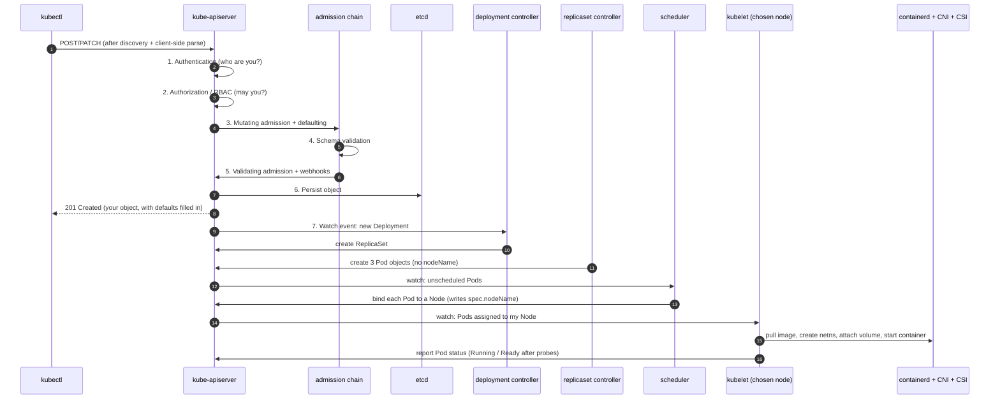

# Architecture 02 — What happens when you run `kubectl apply`

> **Goal:** know the exact sequence of events from `kubectl apply -f deployment.yaml` to a
> running container — and, more importantly, know which event/error text corresponds to which
> stage, so you can localise any failure in seconds.

Prerequisites: [What is Kubernetes](../concepts/01-what-is-kubernetes.md).

---

## 1. The write path (API server)



### Stage by stage

| # | Stage | What happens | Failure appears as |
|---|---|---|---|
| 0 | **Discovery** | `kubectl` reads the API's OpenAPI schema to know what fields exist | `error: the server doesn't have a resource type "foo"`, or an unknown-field warning |
| 1 | **Authentication** | client cert / token / OIDC identifies you | `error: You must be logged in to the server (Unauthorized)` |
| 2 | **Authorization (RBAC)** | the verb+resource+namespace is checked against your bindings | `Error from server (Forbidden): ... cannot create resource ...` |
| 3 | **Mutating admission** | defaulted values are filled in (serviceAccount, imagePullPolicy, strategy, `spec.replicas`), namespace lifecycle, LimitRange injection, and mutating webhooks run | webhook errors surface here verbatim |
| 4 | **Schema validation** | types, required fields, enum values, immutability | `error validating data: ValidationError(...)`, or "field is immutable" |
| 5 | **Validating admission** | policy engines (OPA/Kyverno), Pod Security Admission, `ResourceQuota` | `Error from server (Forbidden): pod-security...`, `exceeded quota` |
| 6 | **Persist to etcd** | the object now exists. Everything before this is a pure request | `etcdserver: request timed out` (control plane unhealthy) |
| 7 | **Controllers react** | each controller watches its kinds and creates the next object down | nothing at all — see §3 |

Two things worth noticing:

- **`kubectl apply` is a merge, not a replace.** By default it is client-side three-way merge
  against the `last-applied-configuration` annotation; with `--server-side` the API server
  performs the merge from field ownership. Fields you remove from the file may not be removed
  from the object — that is why teams move to server-side apply.
- **Nothing about your container happens in this table.** The API server does not start
  processes. It only records intent. Stages 7+ are other components reacting.

---

## 2. The read path is separate

`kubectl get pods` is: authenticate → authorize → read from the **watch cache** (not etcd) →
return. That is why `get` stays fast and cheap even on huge clusters, and why a `get` can show
data that is milliseconds stale.

`kubectl get pods -o yaml` shows `spec` (written by you/controllers) and `status` (written by
the kubelet and controllers). If `status` lags, the *node* is the suspect, not the control
plane.

---

## 3. Scheduling and startup, in detail

### Scheduler

For each unscheduled Pod: **filter** the Nodes that can take it (enough free
requests, node affinity/selector, taints/tolerations, volume topology, Pod count limits),
then **score** the survivors (spread, affinity preferences, image locality), then **bind**.

Failure here is visible as:

```powershell
kubectl describe pod <pod> -n taskflow
# Events:
#  0/1 nodes are available: 1 Insufficient cpu.
#  0/1 nodes are available: 1 node(s) had untolerated taint {...}.
#  0/1 nodes are available: 1 node(s) didn't match Pod's node affinity/selector.
```

The Pod stays `Pending`. That word means **"not scheduled"**, not "broken".

### kubelet

1. Admission checks on the Node (does it fit, are the cgroups sane).
2. **Volume setup** — CSI attach + mount. Failures: `FailedMount`,
   "volume node affinity conflict", "Multi-Attach error".
3. **Image pull** — `Pulling` → `Pulled`. Failures: `ErrImagePull` / `ImagePullBackOff`
   (wrong tag, private registry without `imagePullSecrets`, architecture mismatch).
4. **Network setup** — CNI creates the netns, assigns the Pod IP, wires `veth`.
   Failures: Pods stuck in `ContainerCreating` with CNI errors in kubelet/`describe`.
5. **Container start** — `Created` → `Started`. Failures: `CreateContainerConfigError`
   (missing ConfigMap/Secret), `CreateContainerError`, `RunContainerError`.
6. **Probes** — `startupProbe` must pass before `livenessProbe` arms; `readinessProbe`
   controls endpoint membership. Failures: `Unhealthy` events, then restarts or removal from
   endpoints.

### Status feedback loop

kubelet PATCHes the Pod `status` back to the API server, the EndpointSlice controller updates
endpoints, and the Deployment controller records conditions. That chain is why `kubectl get
deploy` shows `READY 2/3` — it is reporting what the Node told it, not what it asked for.

---

## 4. A worked example, with the actual output

```powershell
kubectl apply -f labs/04-deployment.yaml
# deployment.apps/taskflow-api created

kubectl get deploy,rs,pods -n taskflow
# NAME                            READY   UP-TO-DATE   AVAILABLE
# deployment.apps/taskflow-api     3/3     3            3
# NAME                                       DESIRED   CURRENT   READY
# replicaset.apps/taskflow-api-7d9f8b6c4     3         3         3
# NAME                                READY   STATUS    RESTARTS
# pod/taskflow-api-7d9f8b6c4-abcde    1/1     Running   0
# pod/taskflow-api-7d9f8b6c4-fghij    1/1     Running   0
# pod/taskflow-api-7d9f8b6c4-klmno    1/1     Running   0

kubectl describe pod taskflow-api-7d9f8b6c4-abcde -n taskflow
# Events:
#   Scheduled            Successfully assigned taskflow/... to taskflow
#   Pulling              Pulling image "taskflow-api:1.0.0"
#   Pulled               Successfully pulled image in 1.2s
#   Created              Created container api
#   Started              Started container api
```

Read those Events top to bottom and you have an audit trail of every stage in §3.

### Then a failure, deliberately

```powershell
kubectl set image deploy/taskflow-api api=taskflow-api:9.9.9 -n taskflow
kubectl get pods -n taskflow -w
# taskflow-api-5c4b3a2f1-xxxxx   0/1   ImagePullBackOff

kubectl describe pod taskflow-api-5c4b3a2f1-xxxxx -n taskflow
# Events:
#   Failed  Failed to pull image "taskflow-api:9.9.9": ...
#   Failed  Error: ErrImagePull
#   Normal  BackOff  Back-off pulling image "taskflow-api:9.9.9"
```

`ImagePullBackOff` = stage 3 of the kubelet sequence. `Pending` = the scheduler.
`CrashLoopBackOff` = stage 6 (the app starts and exits). `CreateContainerConfigError` =
stage 5. Four different layers, four different fixes — and all four are visible in the same
`describe` output.

---

## 5. What happens on update and delete

### `kubectl apply` with a changed Pod template

1. API server persists the new Deployment `spec`.
2. The Deployment controller notices the template hash changed → creates a **new ReplicaSet**.
3. It scales the new RS up and the old RS down according to `maxSurge`/`maxUnavailable`,
   waiting for readiness at each step.
4. The old RS is kept at 0 replicas for rollback (`revisionHistoryLimit`).

If only non-template fields changed (e.g. you edited a ConfigMap), **nothing rolls out** —
which is the single most common "I applied it but nothing happened" moment
([Deployment §4](../concepts/03-deployment.md)).

### `kubectl delete pod`

1. `deletionTimestamp` set; the Pod's `status.phase` becomes `Terminating`.
2. The EndpointSlice controller removes it from endpoints (traffic stops first).
3. `preStop` hook runs, then `SIGTERM` to PID 1.
4. The app drains; after `terminationGracePeriodSeconds`, `SIGKILL`.
5. The ReplicaSet controller sees the replica count drop and creates a replacement — a
   **new** Pod with a new name and a new IP.

For a bare Pod, step 5 never happens. That is the whole difference.

### `kubectl delete deployment`

1. The Deployment is removed; its owned ReplicaSets are garbage-collected.
2. ReplicaSets are removed; their owned Pods are garbage-collected.
3. **PVCs are not garbage-collected** when a StatefulSet is deleted — deliberate data
   protection ([Storage §5](../concepts/10-storage-and-volumes.md)).

Ownership is expressed as `metadata.ownerReferences`; cascading deletion walks that graph.
`kubectl get pod <p> -o jsonpath='{.metadata.ownerReferences}'` shows the chain Pod →
ReplicaSet → Deployment, which is a nice way to *see* the object graph from lab step 04.

---

## 6. Check yourself

1. Which component decides *which Node* a Pod runs on? → *kube-scheduler*
2. Your Pod is `Pending`. Which two stages could be at fault? → *admission/quota at create
   time, or the scheduler (no Node fits)*
3. Which component actually pulls the image and starts the container? → *the kubelet on the
   chosen Node, via the CRI runtime*
4. `CreateContainerConfigError` — which stage, and what is the usual cause? → *kubelet
   container creation; a missing ConfigMap/Secret or a missing key*
5. Where does `spec.replicas` defaulting happen if you omit it? → *mutating admission /
   defaulting at the API server*
6. Why does `kubectl get` not go to etcd? → *it reads the API server's watch cache*
7. You edited a ConfigMap; the Deployment did not roll out. Why? → *the Pod template did not
   change; the Deployment controller only reacts to template changes*
8. What happens between "endpoint removed" and "SIGKILL"? → *preStop hook, then SIGTERM, then
   the app's shutdown, bounded by `terminationGracePeriodSeconds`*

---

**Back to:** [Course overview](../overview.md) ·
**Now go do it:** [Lab step 00 — Scenario & requirements](../lab/00-scenario-and-requirements.md)
