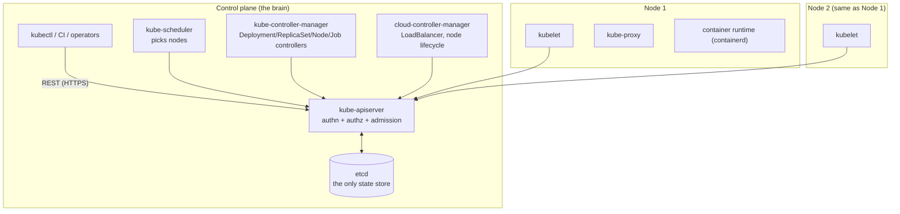

# Concept 01 — What is Kubernetes?

> **In one sentence:** Kubernetes is a control loop that keeps a fleet of machines running
> the workload you *declared*, continuously fixing reality to match your declaration.

Estimated read: 12 minutes. Prerequisite: [the mental model](../getting-started/03-mental-model.md).

---

## 1. The problem it actually solves

The naive way to run an app on a server: SSH in, install dependencies, start a process with
`systemd`, repeat on three servers, and remember which one holds the database. This breaks
down because:

| Problem | Without Kubernetes | With Kubernetes |
|---|---|---|
| A process crashes at 3am | someone gets paged, SSHes in, restarts it | restarted automatically in seconds |
| You need 3x capacity | provision servers, install, deploy, configure LB | change `replicas` from 3 to 9 |
| You need a zero-downtime deploy | custom scripts, health checks, LB surgery | change the image tag; rolling update is built in |
| A machine dies | that machine's work is lost | Pods are rescheduled onto healthy Nodes |
| Config differs per environment | environment-specific builds | same image everywhere; ConfigMaps/Secrets injected at runtime |
| "It works on my laptop" | divergent environments | the image *is* the environment |

Kubernetes is not mainly about running containers. Docker already did that. It is about
**scheduling, self-healing, scaling and declarative rollouts across a pool of machines**.

### Why not Docker Compose / systemd / Ansible?

Because those are *imperative* and *single-machine*. Kubernetes is *declarative* and
*distributed*, and it never stops reconciling. If you `docker run` something and the
container dies, it stays dead. If you `kubectl apply` a Deployment and a Pod dies, the
controller notices and creates a new one — forever, without anyone watching.

---

## 2. The core idea: declarative desired state

Everything in Kubernetes is an **object** with this shape:

```yaml
apiVersion: apps/v1        # which API group/version owns this kind
kind: Deployment           # the type of object
metadata:
  name: taskflow-api
  namespace: taskflow
  labels:  { app: taskflow }     # identity, used by selectors
  annotations: { owner: team-a } # non-identifying metadata
spec:                      # WHAT YOU WANT  (written by you)
  replicas: 3
  ...
status:                    # WHAT IS TRUE   (written by Kubernetes)
  readyReplicas: 3
```

You only ever write `spec`. Kubernetes writes `status`. A **controller** runs a loop:

```
observe actual state  ->  compare with desired state  ->  act to close the gap  ->  repeat
```

Example, in order:

1. You `apply` `replicas: 3`.
2. API server validates it and stores it in etcd.
3. The Deployment controller sees "3 desired, 0 actual" → creates a ReplicaSet.
4. The ReplicaSet controller sees "3 desired, 0 actual Pods" → creates 3 Pod objects.
5. The scheduler sees 3 Pods with no `nodeName` → picks a Node for each and writes it.
6. The kubelet on each Node sees a Pod assigned to it → pulls the image, starts containers,
   runs probes, and reports status back.
7. Ten seconds later a Pod crashes. The loop notices and creates another one.

Nothing in that chain was a command saying "start a container". It is all reconciliation.
When you understand this, `kubectl get pods` stops being magic.

---

## 3. Architecture



### Control plane components

| Component | What it does | Failure impact |
|---|---|---|
| **kube-apiserver** | Single front door for all reads/writes. Authenticates, authorises (RBAC), runs admission webhooks, validates, persists to etcd. | Nothing can change. Running Pods keep running. |
| **etcd** | Consistent key-value store holding the entire cluster state. The only component with real data. | Cluster state lost. **Back this up.** |
| **kube-scheduler** | Watches for Pods with no node; scores Nodes by resources, affinity, taints, topology; binds the Pod. | New Pods stay `Pending`. |
| **kube-controller-manager** | Runs the built-in controllers: Deployment, ReplicaSet, Node, Job, EndpointSlice, ServiceAccount, Namespace, … Each is a reconciliation loop. | No self-healing, no rollouts, no endpoint updates. |
| **cloud-controller-manager** | Talks to the cloud API for load balancers, node lifecycle, routes. Absent locally. | `LoadBalancer` Services stay `Pending`. |

Note what is missing: **the control plane does not run your containers.** It only writes
and reads desired state. This is why a cluster whose control plane is down still serves
traffic.

### Node components

| Component | What it does |
|---|---|
| **kubelet** | The node agent. Watches for Pods assigned to its node, asks the runtime to start containers, mounts volumes, runs probes, reports status. It does **not** manage containers it wasn't told about. |
| **container runtime** | containerd / CRI-O, speaking CRI. Pulls images, runs containers. Docker itself is no longer the runtime. |
| **kube-proxy** | Implements Service virtual IPs: programs iptables/IPVS rules so a Service IP forwards to real Pod IPs. (Being replaced by eBPF dataplanes like Cilium in modern clusters.) |
| **CNI plugin** | Gives Pods IP addresses and enables Pod-to-Pod networking (Calico, Cilium, flannel). Without CNI, Pods have no network. |

### Cluster add-ons (not core, but every real cluster has them)

| Add-on | Purpose |
|---|---|
| CoreDNS | cluster DNS — resolves `service.namespace.svc.cluster.local` |
| CNI plugin | Pod networking + often NetworkPolicy enforcement |
| Ingress controller | makes `Ingress` objects real ([lesson 05](05-ingress.md)) |
| metrics-server | `kubectl top` + HPA |
| CSI driver | dynamic PersistentVolume provisioning ([lesson 10](10-storage-and-volumes.md)) |

---

## 4. The object model in 60 seconds

Everything is a typed, versioned API object:

```powershell
kubectl api-resources          # every kind, its short name, and whether it's namespaced
kubectl api-versions           # the API groups your cluster exposes
kubectl explain deployment     # documentation for a kind, offline
```

- **Namespaced vs cluster-scoped.** Pods, Deployments, Services, ConfigMaps live in a
  namespace. Nodes, PersistentVolumes, ClusterRoles, StorageClasses do not.
- **API groups.** `v1` (core: Pod, Service, ConfigMap), `apps/v1` (Deployment,
  StatefulSet, DaemonSet), `networking.k8s.io/v1` (Ingress, NetworkPolicy), `batch/v1`
  (Job, CronJob), `rbac.authorization.k8s.io/v1` (Role, RoleBinding).
- **Custom Resources (CRDs).** You can add your own kinds. That is how Prometheus,
  Cert-Manager, ArgoCD and every operator extend Kubernetes. Mechanics are identical: a
  controller reconciles your object.
- **Declarative everything.** Any object type can be created with `kubectl apply -f`.

---

## 5. What Kubernetes is *not*

Important, because interviews love this:

- **Not a PaaS.** No build pipeline, no "push and it deploys". You supply images and YAML.
- **Not a CI/CD system.** It *executes* deployments; it does not build or orchestrate
  releases (that is GitHub Actions/ArgoCD/Flux).
- **Not an image registry.** It pulls from one (Docker Hub, GHCR, ECR).
- **Not monitoring or logging.** It exposes data; you install Prometheus/Loki/ELK.
- **Not a database guardian.** A StatefulSet gives Postgres storage and identity, not
  backups, replication or failover. You configure those.
- **Not magic about persistence.** Delete the PVC and your data is gone. Guaranteed.

---

## 6. Local vs managed distributions

| Kind | Examples | Notes |
|---|---|---|
| Managed cloud | EKS, GKE, AKS | You manage no control plane. Costs money. `LoadBalancer` works. |
| Local dev | minikube, kind, k3s, Docker Desktop, k3d | Single node, disposable. This lab uses minikube or Docker Desktop. |
| Bare metal | kubeadm, RKE2, Talos | You run etcd and upgrades yourself. |

Everything in this course is portable: the same manifests run on any conformant cluster.
The only differences you will hit locally are `LoadBalancer` behaviour and the ingress
controller's address ([setup doc](../getting-started/01-local-cluster-setup.md)).

---

## 7. Vocabulary you must have straight

| Term | Meaning |
|---|---|
| **Declarative** | You state the desired end state; the system converges to it |
| **Reconciliation** | The loop comparing desired vs actual and acting on the difference |
| **Controller** | A process implementing a reconciliation loop for one kind |
| **ReplicaSet** | Ensures N identical Pods exist; managed by a Deployment |
| **Selector** | Label query used to *find* Pods (Services, Deployments, NetworkPolicy) |
| **Node** | A machine (VM or physical) in the cluster |
| **Pod** | The smallest deployable unit; one or more containers |
| **Admission controller** | Validating/mutating hook between authz and persistence (e.g. enforce resource limits) |
| **Operator** | A CRD + controller encoding operational knowledge (e.g. "how to run Postgres") |
| **Reconcile loop / level-triggered** | Reacts to *current state*, not to the event that changed it — that is why it self-heals |

---

## 8. Common mistakes

1. **Treating Kubernetes as a place to run things, not a place to declare things.**
   `kubectl edit` in production, hand-edited live state, nobody knows the source of truth.
   If it is not in Git, it does not exist.
2. **Forgetting that the control plane is not in the data path.** Debugging "the API server
   is slow" when traffic never touches it.
3. **Assuming namespaces isolate anything by default.** They do not; you need
   NetworkPolicy, RBAC and quotas ([lesson 12](12-namespaces-rbac-and-quotas.md)).
4. **Not setting resource requests/limits.** One greedy Pod can starve a node.
5. **Assuming state is safe in a container.** Containers are ephemeral; only volumes
   persist ([lesson 10](10-storage-and-volumes.md)).
6. **Making a bare Pod.** No controller means no self-healing ([lesson 02](02-pod.md)).

---

## 9. Check yourself

1. Which control plane component is the only one that stores state? → *etcd*
2. A Pod is stuck in `Pending`. Which component is probably failing? → *the scheduler (or
   resource shortage / unschedulable node)*
3. The control plane is down. Are your Pods still serving traffic? → *Yes — kubelet and
   kube-proxy keep going; only changes stop*
4. What makes Kubernetes self-healing? → *controllers continuously reconciling desired vs
   actual state*
5. What is the difference between `spec` and `status`? → *spec is your declaration; status
   is the observed reality written by controllers*
6. Name three things Kubernetes does NOT provide for a database. → *backups, replication,
   failover*

---

**Practice it:** [Lab step 01 — Bootstrap the cluster](../lab/01-bootstrap-cluster-and-tools.md)
