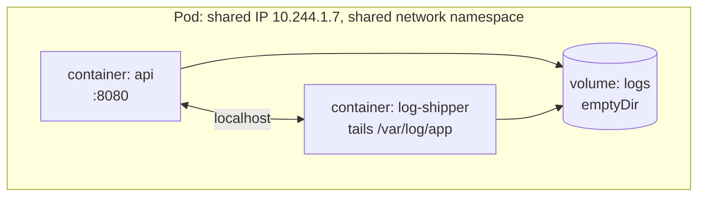

# Concept 02 — Pod

> **In one sentence:** A Pod is the smallest thing Kubernetes can schedule — a group of
> one or more containers that share a network namespace, IP address and volumes, and that
> are always placed on the same Node.

Estimated read: 10 minutes.

---

## 1. Why not just "a container"?

Because Kubernetes needed a unit that can be scheduled **atomically** and that can hold
things containers cannot express on their own:

- **A shared network identity.** All containers in a Pod share one IP and one port space,
  so they reach each other on `localhost`. That is what makes sidecars possible.
- **A shared lifecycle.** All containers in a Pod start and stop together, on the same Node.
- **Shared storage.** Volumes declared at Pod level can be mounted by several containers.
- **A place for infrastructure containers.** Init containers, sidecars, log shippers and
  proxies that support the main process but are not it.

If the Pod *were* just a container, a "main app + log shipper" pair would have to be
scheduled separately and find each other over the network. The Pod makes them one unit
without merging them into one image (which would be the anti-pattern of a fat container).

> **Rule of thumb:** one Pod = one *primary* concern. Add extra containers only when they
> are meaningless without the main one.

---

## 2. Anatomy



An important subtlety: containers in a Pod share the **network namespace** but not the
filesystem or process tree (unless you set `shareProcessNamespace: true`). Different
containers still have separate root filesystems, which is exactly why you pass data
through volumes.

### The three multi-container patterns

| Pattern | Shape | Example |
|---|---|---|
| **Sidecar** | Extra container enhances the main one, same lifecycle | log shipper, Envoy proxy in a service mesh, TLS terminator |
| **Ambassador** | Extra container proxies *outbound* connections | Cloud SQL Auth Proxy, a legacy-API adapter |
| **Adapter** | Extra container normalises the main container's output | converts an app's metrics to Prometheus format |

Plus **init containers**: run to completion, in order, *before* the app containers start.
Use them for "wait for the database to be reachable", "git clone a repo", "run DB
migrations before serving traffic". They are the closest thing Kubernetes has to a
pre-flight step inside a Pod.

```yaml
spec:
  initContainers:
    - name: wait-for-postgres
      image: busybox:1.36
      command: ['sh','-c','until nc -z postgres 5432; do echo waiting; sleep 2; done']
  containers:
    - name: api
      image: taskflow-api:1.0.0
```

### Per-container and per-Pod fields

| Field | Level | Notes |
|---|---|---|
| `image`, `command`, `args`, `env`, `volumeMounts`, `resources`, `livenessProbe`, `readinessProbe` | container | things that are genuinely per-process |
| `volumes`, `restartPolicy`, `serviceAccountName`, `nodeSelector`, `affinity`, `tolerations`, `securityContext` | Pod | things that must apply to the whole group |

`securityContext` can be set at both levels; container-level wins for overlapping fields.

---

## 3. Lifecycle: fast version

**Phase** (coarse, on the Pod):

| Phase | Meaning |
|---|---|
| `Pending` | Accepted, but not all containers are running — usually scheduling, image pull, or init containers |
| `Running` | Bound to a Node; at least one container running |
| `Succeeded` | All containers exited 0 and will not restart (Jobs) |
| `Failed` | All containers terminated and at least one failed |
| `Unknown` | Can't reach the Node |

**Container states** (fine-grained, per container) — this is where the useful detail is:

`Waiting` (with `Reason`: `ImagePullBackOff`, `CrashLoopBackOff`, `ContainerCreating`) →
`Running` → `Terminated` (with `Reason`: `Completed`, `Error`, `OOMKilled`, `ContainerCannotRun`).

```powershell
kubectl get pod sample-pod -o jsonpath='{.status.phase}'
kubectl get pod sample-pod -o jsonpath='{.status.containerStatuses[0].state}'
kubectl describe pod sample-pod          # lastState + Events tell the real story
```

### Termination and graceful shutdown

1. Pod is marked `Terminating` and removed from Service endpoints *first* (so traffic stops
   arriving), then containers get **SIGTERM**.
2. The app should stop accepting new work, finish in-flight requests, close DB connections
   and exit.
3. After `terminationGracePeriodSeconds` (default **30**, `3700` is fine for a dev box but
   too long in production) the container gets **SIGKILL**.

Set it explicitly for anything that holds connections, and make sure your app handles
SIGTERM — otherwise every deploy drops requests.

### `restartPolicy`

| Value | Use |
|---|---|
| `Always` (default) | long-running services. Backed by a controller, this is what you want |
| `OnFailure` | Jobs that should retry |
| `Never` | one-shot Pods where retries are meaningless |

The restart is done by the **kubelet**, with exponential backoff (10s, 20s, 40s… capped at
5 minutes). That is `CrashLoopBackOff` — it does not mean "broken", it means "restarting
with backoff, look at the logs".

### QoS classes (derived, not set)

| Class | Condition | Eviction priority |
|---|---|---|
| `Guaranteed` | every container has requests == limits for CPU and memory | evicted last |
| `Burstable` | requests set, limits higher (or only some containers set) | middle |
| `BestEffort` | no requests or limits at all | evicted **first** |

This matters when a node is under memory pressure. Setting requests and limits is not
optional in production ([lesson 11](11-probes-resources-and-scaling.md)).

---

## 4. The full YAML, annotated

```yaml
apiVersion: v1
kind: Pod
metadata:
  name: taskflow-api-demo
  namespace: taskflow
  labels:
    app.kubernetes.io/name: taskflow-api      # selectors match on this
    app.kubernetes.io/component: backend
    app.kubernetes.io/part-of: taskflow
spec:
  serviceAccountName: taskflow-api            # identity for talking to the API (RBAC)
  terminationGracePeriodSeconds: 30
  securityContext:                            # defaults for all containers
    runAsNonRoot: true
    runAsUser: 1000
    fsGroup: 1000                             # group ownership of mounted volumes
  containers:
    - name: api
      image: taskflow-api:1.0.0               # never :latest outside of experiments
      imagePullPolicy: IfNotPresent           # IfNotPresent for local images
      ports:
        - name: http                          # named ports let Services target them
          containerPort: 8080
      env:
        - name: APP_ENV
          value: "lab"
        - name: DB_PASSWORD                   # from a Secret, not hard-coded
          valueFrom:
            secretKeyRef: { name: taskflow-secret, key: DB_PASSWORD }
      envFrom:
        - configMapRef: { name: taskflow-config }   # bulk-import every key
      resources:                              # requests = scheduling; limits = cap
        requests: { cpu: 100m, memory: 128Mi }
        limits:   { cpu: 500m, memory: 256Mi }
      livenessProbe:                          # "restart me if I'm wedged"
        httpGet: { path: /healthz, port: http }
        initialDelaySeconds: 10
        periodSeconds: 10
        failureThreshold: 3
      readinessProbe:                          # "don't send me traffic yet"
        httpGet: { path: /readyz, port: http }
        initialDelaySeconds: 5
        periodSeconds: 5
      volumeMounts:
        - name: tmp
          mountPath: /tmp
  volumes:
    - name: tmp
      emptyDir: {}                            # scratch space, deleted with the Pod
```

Note what is *not* here: no `replicas`, no `selector`, no rollout strategy. A bare Pod has
none of those, because nothing manages it.

---

## 5. Why a bare Pod is almost always wrong

| Consequence | Detail |
|---|---|
| No self-healing | delete it, it is gone. Node fails, it is gone |
| No scaling | there is no "how many" field |
| No rolling updates | you cannot change the image without downtime |
| No Service integration | you *can* label it and select it, but the endpoints churn as it is replaced |

Bare Pods are still useful for two things:

1. **Learning** — `sample.yaml` in this repo.
2. **Debugging** — `kubectl run tmp --rm -it --image=busybox:1.36 --restart=Never -- sh`
   for a throwaway network shell.

Everything else uses a controller: Deployment, StatefulSet, DaemonSet, Job.

---

## 6. Commands

```powershell
# create / inspect
kubectl apply -f sample.yaml
kubectl get pod sample-pod -o wide
kubectl describe pod sample-pod
kubectl get pod sample-pod -o yaml

# interact
kubectl logs sample-pod
kubectl exec -it sample-pod -- sh
kubectl port-forward pod/sample-pod 8080:80      # reach it without a Service
kubectl cp sample-pod:/etc/hostname ./hostname   # copy files in/out

# delete (watch what happens — with a bare Pod, nothing)
kubectl delete pod sample-pod
```

---

## 7. Common mistakes

1. **Using a bare Pod in production.** No controller, no self-healing.
2. **`image: myapp:latest`.** Not reproducible; `imagePullPolicy: Always` will pull a
   different image under you and make rollbacks meaningless.
3. **No resource requests.** The Pod is `BestEffort` and is the first thing evicted when a
   node runs out of memory.
4. **Multiple unrelated processes in one container.** You cannot scale or restart them
   independently, and the container's exit code becomes ambiguous. Use a sidecar instead.
5. **Assuming data in a container's filesystem survives.** It does not — restart and it is
   gone. Only volumes persist ([lesson 10](10-storage-and-volumes.md)).
6. **No readiness probe.** The Pod receives traffic before it is ready, and every deploy
   produces a burst of 502s.
7. **Ignoring SIGTERM.** The Pod is killed mid-request after 30 seconds.
8. **`enableServiceLinks` surprises.** Kubernetes injects env vars for every Service in the
   namespace; with many Services this can break badly-written apps. Usually harmless, but
   worth knowing.
9. **Pod IPs in config.** They change. That is the entire reason
   [Services](04-service.md) exist.

---

## 8. Check yourself

1. Two containers in one Pod — can they both bind port 8080? → *No. One shared network
   namespace, one port space*
2. How does a sidecar share files with the main container? → *a Pod-level volume mounted by
   both*
3. Pod is `Running` but receives no traffic. Which probe do you check? → *readiness*
4. What does `CrashLoopBackOff` actually tell you? → *the container keeps exiting and the
   kubelet is restarting it with exponential backoff — check `logs --previous`*
5. Pod is stuck in `Pending` for 10 minutes. Name three possible causes. → *insufficient
   CPU/memory on all Nodes, unschedulable Node (taint/affinity), unbound PVC, image pull
   stalls for large images*
6. Which is deleted first on scale-down, the oldest or the newest Pod? → *the newest,
   unless you configure the ReplicaSet; endpoints are removed before SIGTERM either way*
7. What is the difference between an init container and a sidecar? → *init containers run
   to completion before the app starts; sidecars run alongside it*

---

**Practice it:** [Lab step 03 — Your first Pod](../lab/03-pods-first-contact.md) ·
**Next lesson:** [Deployment](03-deployment.md)
