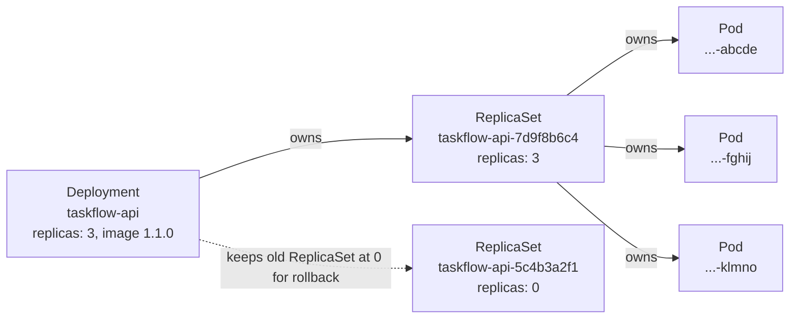

# Concept 03 — Deployment

> **In one sentence:** A Deployment declares "keep N identical copies of this Pod template
> running" and gives you self-healing, scaling, rolling updates and rollback through
> ReplicaSets.

Estimated read: 12 minutes. Prerequisite: [Pod](02-pod.md).

---

## 1. The problem it solves

A bare Pod has no supervisor: delete it and it is gone. You need something that:

- keeps a **desired number** of identical Pods alive (self-healing),
- lets you **change the image** without downtime (rolling update),
- lets you **undo** a bad change instantly (rollback),
- gives you **horizontal scale** by editing one number,
- spreads Pods across Nodes for availability.

A Deployment does all of that. It is the default controller for stateless workloads — which
is the majority of what you will deploy.

---

## 2. The ownership chain (this is the part people get wrong)



- You never create a ReplicaSet by hand. The Deployment controller does it.
- **A new ReplicaSet is created for every change to the Pod template.** That is how
  rollback works: `kubectl rollout undo` just scales the old ReplicaSet back up.
- Because of this, `kubectl get pods` showing Pod names with a ReplicaSet hash is normal,
  and pod names change on every deploy.

```powershell
kubectl get deploy,rs,pods -n taskflow -o wide
kubectl rollout history deployment/taskflow-api -n taskflow
```

---

## 3. The YAML

```yaml
apiVersion: apps/v1
kind: Deployment
metadata:
  name: taskflow-api
  namespace: taskflow
  labels:
    app.kubernetes.io/name: taskflow-api
    app.kubernetes.io/part-of: taskflow
spec:
  replicas: 3
  revisionHistoryLimit: 5          # how many old ReplicaSets to keep for rollback
  selector:
    matchLabels:
      app.kubernetes.io/name: taskflow-api    # MUST match template labels
  strategy:
    type: RollingUpdate
    rollingUpdate:
      maxSurge: 1                  # add 1 extra Pod above replicas
      maxUnavailable: 0            # never drop below 3 ready Pods
  minReadySeconds: 5               # a new Pod must be ready 5s before it counts
  progressDeadlineSeconds: 600     # fail the rollout if it stalls
  template:                        # <-- a Pod spec, minus apiVersion/kind
    metadata:
      labels:
        app.kubernetes.io/name: taskflow-api
    spec:
      terminationGracePeriodSeconds: 30
      containers:
        - name: api
          image: taskflow-api:1.0.0
          ports: [{ name: http, containerPort: 8080 }]
          resources:
            requests: { cpu: 100m, memory: 128Mi }
            limits:   { cpu: 500m, memory: 256Mi }
          readinessProbe:
            httpGet: { path: /readyz, port: http }
```

### The three labels/selectors traps

1. **`selector.matchLabels` must match `template.metadata.labels`.** If they do not,
   the API server rejects the object (which is better than the old behaviour of silently
   adopting every matching Pod in the namespace).
2. **`selector` is immutable.** You cannot change it on an existing Deployment — delete and
   recreate instead.
3. **Selectors are a live query.** If two Deployments use the same selector, they will
   fight over the same Pods. Always namespace your labels.

---

## 4. Rolling updates, in detail

`strategy.rollingUpdate` has exactly two knobs, and their meaning is relative to the
service capacity you promised:

| Setting | `maxUnavailable: 0` (safe) | `maxUnavailable: 1` (fast) |
|---|---|---|
| Extra capacity during deploy | `maxSurge: 1` → 4 Pods briefly | none |
| Zero-downtime? | yes, **if** readiness probes are correct | no, brief capacity dip |
| Needs spare room on Nodes | yes | no |

The update sequence with `maxSurge: 1, maxUnavailable: 0`:

1. New ReplicaSet created with the new template (0 replicas).
2. Scale new RS to 1 → wait until the Pod is **Ready** (`minReadySeconds` also satisfied).
3. Scale old RS down by 1 (that Pod is removed from Service endpoints first).
4. Repeat until the old RS is 0 and the new RS is at 3.

Key insight: **without a readiness probe this is not zero-downtime at all** — a Pod counts
as "ready" the moment the container starts, so traffic is routed to an app that is still
booting. Probes are not optional ([lesson 11](11-probes-resources-and-scaling.md)).

### Recreate strategy

`strategy.type: Recreate` kills all Pods before starting new ones. Use only for workloads
that genuinely cannot run two versions at once (a singleton with an exclusive lock, an
incompatible schema migration). Expect downtime.

### Rollout commands

```powershell
kubectl set image deployment/taskflow-api api=taskflow-api:1.1.0 -n taskflow
kubectl rollout status deployment/taskflow-api -n taskflow
kubectl rollout history deployment/taskflow-api -n taskflow
kubectl rollout undo deployment/taskflow-api -n taskflow              # previous revision
kubectl rollout undo deployment/taskflow-api --to-revision=2 -n taskflow
kubectl rollout restart deployment/taskflow-api -n taskflow           # force a new RS
kubectl rollout pause  deployment/taskflow-api -n taskflow            # canary control
kubectl rollout resume deployment/taskflow-api -n taskflow
```

`kubectl rollout pause` + `resume` is a cheap canary: pause after the first new Pod is
ready, verify, then resume. Useful when you have no service mesh.

### When a rollout gets stuck

```powershell
kubectl rollout status deployment/taskflow-api -n taskflow   # says the reason
kubectl get rs -n taskflow
kubectl describe deploy taskflow-api -n taskflow              # Events
kubectl get pods -n taskflow -l app.kubernetes.io/name=taskflow-api
kubectl logs <new-pod> -n taskflow
```

Typical causes: `ImagePullBackOff`, a readiness probe that never passes, insufficient
resources so the new Pod stays `Pending`, a bad `ConfigMap` key making the app exit,
`progressDeadlineSeconds` exceeded. Fix the cause, then `kubectl rollout undo` or apply the
fix.

---

## 5. Scaling

```powershell
kubectl scale deployment/taskflow-api --replicas=6 -n taskflow
kubectl autoscale deployment/taskflow-api --min=2 --max=8 --cpu-percent=70 -n taskflow
```

Scaling a Deployment is just changing a number; the ReplicaSet does the rest. Two things to
remember:

- **Replicas are Pods, not containers.** Memory is not shared; each replica needs its own
  resources.
- **A Deployment cannot scale a database.** Stateless only. Anything with identity uses a
  [StatefulSet](07-statefulset.md).

`kubectl autoscale` creates an `HorizontalPodAutoscaler`; scale-to-`0` for cost saving on
non-production namespaces is common, but never for something in the request path without a
queue in front.

---

## 6. Scheduling: helping the scheduler help you

Replicas are spread by the scheduler, but you can influence it:

```yaml
spec:
  template:
    spec:
      topologySpreadConstraints:            # spread across zones/nodes evenly
        - maxSkew: 1
          topologyKey: kubernetes.io/hostname
          whenUnsatisfiable: ScheduleAnyway
          labelSelector:
            matchLabels: { app.kubernetes.io/name: taskflow-api }
      affinity:
        podAntiAffinity:                     # never two API Pods on the same Node
          preferredDuringSchedulingIgnoredDuringExecution:
            - weight: 100
              podAffinityTerm:
                topologyKey: kubernetes.io/hostname
                labelSelector:
                  matchLabels: { app.kubernetes.io/name: taskflow-api }
      nodeSelector:
        kubernetes.io/os: linux
```

`requiredDuringScheduling` will leave Pods `Pending` if no Node satisfies it — use it
deliberately. `preferred` degrades gracefully.

---

## 7. Deployment vs the other controllers

| Use a… | When |
|---|---|
| **Deployment** | stateless, replicas interchangeable, rolling update wanted (API, worker, frontend) |
| **StatefulSet** | stable identity + own storage (database, queue, search index) |
| **DaemonSet** | one Pod per Node (agent, log shipper, CSI plugin) |
| **Job / CronJob** | runs to completion, then stops |
| **ReplicaSet alone** | essentially never — you lose rollouts |

---

## 8. Common mistakes

1. **No readiness probe + `maxUnavailable: 0`.** Feels safe, is not. Brief 502s every deploy.
2. **`replicas: 1` in production.** One node drain = downtime.
3. **No PodDisruptionBudget.** A node drain or cluster upgrade can take all replicas at once
   ([lesson 11](11-probes-resources-and-scaling.md)).
4. **Changing `selector`** → rejected by the API. Recreate the Deployment.
5. **Editing Pod templates with `kubectl edit`** and never writing it back to Git.
6. **Assuming `apply` always rolls out.** If the Pod template did not change (e.g. you only
   changed a ConfigMap), the Deployment does not restart anything — you need
   `kubectl rollout restart`, or better, a checksum annotation on the Pod template.
7. **Mixing config into images per environment.** Same image everywhere; inject config.
8. **Forgetting that old ReplicaSets linger.** They are kept for rollback
   (`revisionHistoryLimit`) and each one holds onto its Pod template. Harmless, but clean up
   in big clusters.

---

## 9. Check yourself

1. Why does `kubectl get pods` show a random string in Pod names? → *the ReplicaSet hash —
   new RS per template change, which is what enables rollback*
2. You changed a ConfigMap the Deployment mounts. Do Pods restart? → *No. Not by default.
   Use `rollout restart` or a checksum annotation*
3. `maxSurge: 1, maxUnavailable: 0` with `replicas: 3` — how many Pods exist at peak? → *4*
4. How do you roll back two revisions? → *`kubectl rollout undo --to-revision=N`*
5. Deployment stuck with 3 old Pods Running and the new Pod `Pending`. First command? →
   *`kubectl describe pod <new-pod>` — most likely insufficient resources or an
   unsatisfiable nodeSelector/affinity*
6. Why is a Deployment inappropriate for Postgres? → *replicas are anonymous and
   interchangeable, share no identity, no stable name, and multiple writers to one volume
   is unsafe*

---

**Practice it:** [Lab step 04 — Deployment](../lab/04-deployment-and-image.md) ·
**Next lesson:** [Service](04-service.md)
