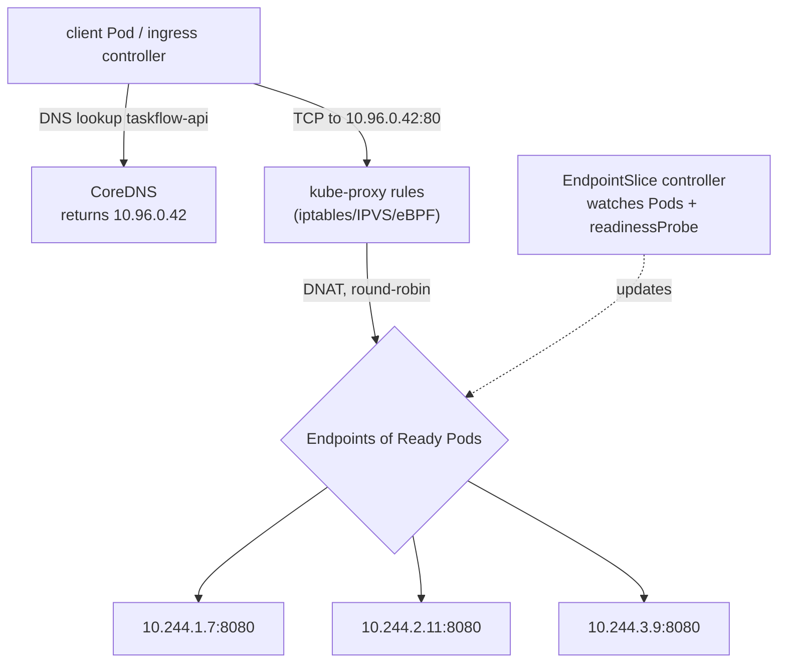

# Concept 04 — Service

> **In one sentence:** A Service gives a changing set of Pods one permanent virtual IP and
> DNS name, and load-balances traffic across only the Pods that are currently *ready*.

Estimated read: 12 minutes. Prerequisite: [Deployment](03-deployment.md).

---

## 1. The problem it solves

After lab step 04 you have three API Pods with three IP addresses:

```
taskflow-api-7d9f8b6c4-abcde   10.244.1.7   Running
taskflow-api-7d9f8b6c4-fghij   10.244.2.11  Running
taskflow-api-7d9f8b6c4-klmno   10.244.3.9   Running
```

Now: which address does the worker call? All three? What happens after a deploy, when all
three IPs change, or when a Pod is rescheduled to another Node and gets a new IP?

And your *frontend* would need the same answer, and your *Postgres* client too. Hard-coding
Pod IPs is impossible — they are guaranteed to change.

A **Service** puts a stable layer in front of them:

```
             fixed forever                     changes constantly
  taskflow-api.taskflow.svc.cluster.local:80  ->  10.244.1.7:8080
                                    10.96.0.42 ->  10.244.2.11:8080   (only Ready Pods)
                                                  10.244.3.9:8080
```

Consumers only ever reference the Service. Pods come and go behind it.

---

## 2. How it actually works



Notice three separate mechanisms:

1. **DNS** — CoreDNS resolves the Service name to the ClusterIP. (Only inside the cluster.)
2. **ClusterIP** — a *virtual* IP that exists only in iptables/IPVS/eBPF rules. Nothing
   listens on it; there is no interface with that address.
3. **EndpointSlices** — the list of Pod IPs behind the Service, maintained by a controller
   from the **label selector ∩ Pod readiness**.

Point 3 is the one that makes zero-downtime deploys work: when a Pod fails its readiness
probe or is terminating, it is removed from the EndpointSlice and stops receiving traffic
*before* it is killed.

> **The number-one Service bug:** "the Service doesn't work" is almost always "the selector
> matches no Pods, so the EndpointSlice is empty". Always check endpoints first.

```powershell
kubectl get endpointslices -n taskflow -l kubernetes.io/service-name=taskflow-api
# or the classic shorthand:
kubectl get endpoints -n taskflow
```

---

## 3. Service types

| Type | What you get | Reachable from | Typical use |
|---|---|---|---|
| **ClusterIP** (default) | virtual IP inside the cluster | inside the cluster only | internal services: DB, Redis, API-to-API |
| **NodePort** | ClusterIP + the same port opened on **every** Node (`30000-32767`) | any node's IP | quick manual testing, no LB available |
| **LoadBalancer** | NodePort + a cloud load balancer | internet (if configured) | one-off public services; cloud only |
| **ExternalName** | a DNS CNAME, **no** proxy, no IP | inside the cluster | pointing at an external managed DB |

```yaml
apiVersion: v1
kind: Service
metadata:
  name: taskflow-api
  namespace: taskflow
spec:
  type: ClusterIP
  selector:
    app.kubernetes.io/name: taskflow-api   # <-- this is the entire "wiring"
  ports:
    - name: http            # name it when there is more than one port
      port: 80              # what clients connect to
      targetPort: http      # what the container listens on (named port -> resolves to 8080)
      protocol: TCP
```

| Field | Meaning | Classic mistake |
|---|---|---|
| `port` | the Service's port — what clients use | confusing it with `targetPort` |
| `targetPort` | the container's port (number or **named** port from the Pod spec) | wrong number → connection refused, but endpoints look healthy |
| `nodePort` | the port on every Node (NodePort/LoadBalancer only) | omitted → one is auto-assigned |
| `selector` | label query to find Pods | mismatched labels → empty endpoints |

**Naming the container port** (`ports: [{name: http, containerPort: 8080}]`) and then using
`targetPort: http` is the professional habit: changing the container port later does not
break the Service.

> Namespace note: a Service can only select Pods **in its own namespace**. Cross-namespace
> traffic is still possible — you just need a Service in each namespace (or an
> `ExternalName`/Ingress), which is the point of namespaces.

---

## 4. Headless Services

Setting `clusterIP: None` makes the Service **headless**: no virtual IP, no load balancing.
DNS instead returns an **A record per Pod**:

```yaml
apiVersion: v1
kind: Service
metadata:
  name: postgres
spec:
  clusterIP: None                 # headless
  selector:
    app.kubernetes.io/name: postgres
  ports:
    - port: 5432
      targetPort: 5432
```

```powershell
nslookup postgres.taskflow.svc.cluster.local
# 10.244.4.5      <- the ClusterIP, for a normal Service
# or, for a headless Service: every Pod IP
```

Why you need it: a **StatefulSet's** whole point is that clients can address one specific
replica — `postgres-0.postgres.taskflow.svc.cluster.local`. That per-Pod DNS name only
exists if the governing Service is headless ([lesson 07](07-statefulset.md)).

---

## 5. DNS inside the cluster

CoreDNS resolves, in order of the search path:

| You write | Resolves to |
|---|---|
| `taskflow-api` | same namespace |
| `taskflow-api.taskflow` | that namespace |
| `taskflow-api.taskflow.svc` | same thing, explicit |
| `taskflow-api.taskflow.svc.cluster.local` | fully qualified (FQDN) — always use this in configs |

```
# a Pod's /etc/resolv.conf
search taskflow.svc.cluster.local svc.cluster.local cluster.local
nameserver 10.96.0.10
options ndots:5
```

Practical consequence: `DB_HOST=postgres` works inside the `taskflow` namespace, but from
another namespace you must write `postgres.taskflow`. Prefer the FQDN in ConfigMaps so
config does not silently depend on which namespace the Pod runs in.

---

## 6. Advanced knobs worth knowing

| Field | Effect |
|---|---|
| `sessionAffinity: ClientIP` (with `sessionAffinityConfig.timeoutSeconds`) | sticky sessions — usually a sign you should use a real session store instead |
| `internalTrafficPolicy: Local` | route only to Pods on the same Node (saves a hop, risks imbalance) |
| `externalTrafficPolicy: Local` / `Cluster` | NodePort/LB only; `Local` preserves the client source IP but drops Nodes without a local Pod |
| `publishNotReadyAddresses: true` | include not-ready Pods in DNS — needed by some clustered apps during bootstrap |
| `ipFamilyPolicy` | dual-stack IPv4/IPv6 |
| `trafficDistribution: PreferClose` | topology-aware routing, prefer the nearest zone |

**Why `externalTrafficPolicy` matters:** with the default `Cluster`, an incoming connection
is DNAT'd to some Pod anywhere, so the Pod sees the *Node's* IP as the client — you lose the
real client IP (bad for rate limiting/audit logs). `Local` preserves it but requires a Pod
on every Node that receives traffic. Kubernetes 1.22+ partly fixes this with
`spec.externalTrafficPolicy` + `Ingress` annotations such as
`nginx.ingress.kubernetes.io/use-forwarded-headers`.

---

## 7. Debugging checklist

```powershell
kubectl get svc taskflow-api -n taskflow -o wide
kubectl describe svc taskflow-api -n taskflow          # shows Selector + Endpoints
kubectl get endpointslices -n taskflow -l kubernetes.io/service-name=taskflow-api
kubectl get pods -n taskflow -l app.kubernetes.io/name=taskflow-api --show-labels
kubectl port-forward svc/taskflow-api 8080:80 -n taskflow   # test the Service locally
```

| Symptom | Cause |
|---|---|
| `Endpoints: <none>` | selector does not match any Pod labels, or no Pods are Ready |
| Endpoints exist but connection refused | `targetPort` wrong, or the app listens on `127.0.0.1` instead of `0.0.0.0` |
| Works in one namespace, not another | unqualified DNS name; use the FQDN |
| Works via `port-forward` but not from a Pod | DNS problem (check CoreDNS) or a NetworkPolicy ([lesson 06](06-egress.md)) |
| Intermittent 502s during deploys | missing readiness probe, so not-ready Pods get traffic |
| `port-forward` to a Service is slow but works | normal; it selects one Pod and stays with it |

Note: **`port-forward` bypasses the Service's load balancing** in practice (it picks one
Pod). To test real load balancing, call the Service name from another Pod:

```powershell
kubectl run tmp --rm -it --image=busybox:1.36 --restart=Never -n taskflow -- sh
# inside:
for i in 1 2 3 4 5 6; do wget -qO- http://taskflow-api/whoami; echo; done
```

---

## 8. Common mistakes

1. **Assuming a Service load-balances like a real LB.** It is L4 (TCP/UDP), round-robin per
   *connection*, not per request, with no health checking beyond readiness and no retries.
   For HTTP-level behaviour you want an Ingress or a service mesh.
2. **Forgetting that ClusterIP is cluster-internal.** It is invisible from your laptop. Use
   `port-forward`, NodePort, LoadBalancer or Ingress to reach it.
3. **Using `NodePort` in production** as the public entry point: ugly ports, no TLS, no host
   routing, one per service. Use [Ingress](05-ingress.md).
4. **One Service with multiple selectors.** Impossible — one Service, one selector. Create
   two Services.
5. **`type: LoadBalancer` on a local cluster.** It stays `<pending>` forever (no cloud
   controller). Use `minikube tunnel`, or Ingress.
6. **Deleting and recreating a Service unnecessarily.** The ClusterIP is stable across
   updates but a delete/recreate can change it and break hard-coded IPs (which is why you
   should use DNS names).
7. **Forgetting `protocol`/port names** with multiple ports → `kubectl` rejects it or you
   mis-wire the Ingress.

---

## 9. Check yourself

1. How many Pods does a Service need to exist? → *at least one matching and Ready, otherwise
   the endpoints are empty*
2. Where is the load-balancing decision actually made? → *in each client Node's
   kube-proxy/eBPF rules, not in a central proxy*
3. What single command tells you why a Service is not working? → *`kubectl describe svc` /
   `kubectl get endpointslices` — look at Endpoints*
4. `port` vs `targetPort`? → *port = what clients call; targetPort = container's listening
   port*
5. Why does a StatefulSet need a headless Service? → *to give each Pod a stable per-Pod DNS
   record instead of a load-balanced VIP*
6. You lose the client's source IP behind an Ingress. Name two fixes. → *`externalTrafficPolicy:
   Local` on the NodePort/LoadBalancer Service, and configuring the ingress controller to
   trust and forward `X-Forwarded-For`*
7. Does a Service provide TLS? → *No. TLS termination happens at the Ingress or in the app.*

---

**Practice it:** [Lab step 05 — Service](../lab/05-service.md) ·
**Next lesson:** [Ingress](05-ingress.md)
