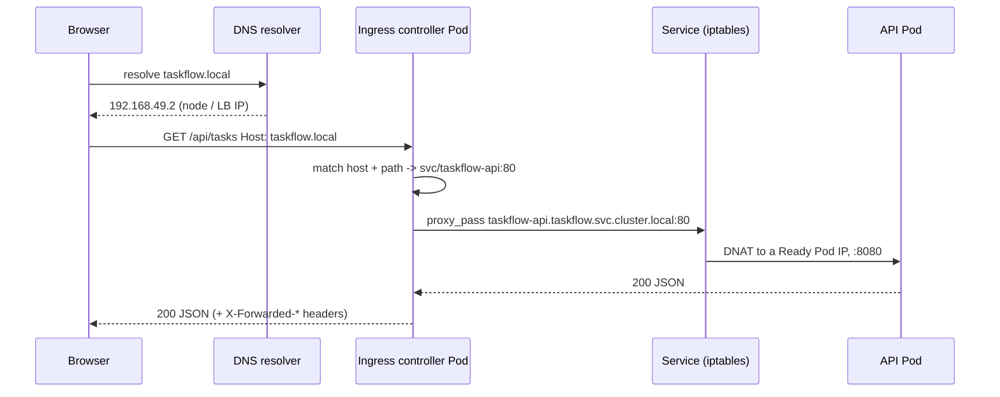

# Concept 05 — Ingress

> **In one sentence:** An Ingress is a single, shared entry point into the cluster that
> routes external HTTP/HTTPS traffic to internal Services by hostname and path — but it
> only works if an **Ingress controller** is installed.

Estimated read: 12 minutes. Prerequisite: [Service](04-service.md).

---

## 1. The problem it solves

You have five services that need to be reachable from outside: the API, the frontend, the
admin panel, Grafana, and a webhook receiver. The options without Ingress are all bad:

| Approach | Problem |
|---|---|
| One `LoadBalancer` Service each | five cloud load balancers, five bills, five IPs, five certs, five DNS entries, no path routing |
| One `NodePort` each | ports like `:31245`, no TLS, no host routing, clients must know the port |
| A hand-built nginx VM | outside Kubernetes, manual config, not declarative, drifts |

What you actually want is **one front door**: one IP, one certificate, and routing rules
based on the request's `Host` header and URL path. That is the Ingress.

```
                       ┌────────────────────────────────────────────┐
   one IP, one cert ──▶│        ingress-nginx controller            │
                       └───┬────────────┬────────────┬──────────────┘
   taskflow.local/api      │            │            │   admin.taskflow.local
                           ▼            ▼            ▼
                  svc/taskflow-api  svc/frontend  svc/admin
```

---

## 2. Ingress object vs Ingress controller — the distinction that trips everyone up

| | What it is | Analogy |
|---|---|---|
| **`Ingress`** (a Kubernetes object) | a *declaration*: "host `taskflow.local`, path `/api` → Service `taskflow-api:80`" | a page of nginx `server {}` config, in YAML |
| **Ingress controller** | the running proxy (a Deployment + Service + Pods) that *watches* Ingress objects and reconfigures itself | the nginx process itself |

**A cluster with no Ingress controller ignores every Ingress object.** Nothing errors;
`kubectl get ingress` shows it with no `ADDRESS`; requests get connection refused. This is
by far the most common Ingress confusion.

Popular controllers: **ingress-nginx** (what this lab uses), Traefik, HAProxy, Kong,
Contour, AWS ALB, GCE. The `Ingress` API is standard; the **annotations are
controller-specific** — that is why the `nginx.ingress.kubernetes.io/*` annotations in this
lab will not work on Traefik.

```powershell
kubectl get ingressclass                       # what the cluster supports
kubectl get pods -n ingress-nginx              # is the controller actually running?
kubectl get ingress -n taskflow                # ADDRESS empty => controller missing
```

---

## 3. The YAML

```yaml
apiVersion: networking.k8s.io/v1
kind: Ingress
metadata:
  name: taskflow
  namespace: taskflow
  annotations:
    nginx.ingress.kubernetes.io/rewrite-target: /$2
    nginx.ingress.kubernetes.io/ssl-redirect: "false"     # local lab: no TLS yet
    nginx.ingress.kubernetes.io/proxy-body-size: "10m"
spec:
  ingressClassName: nginx                 # which controller should honour this
  rules:
    - host: taskflow.local
      http:
        paths:
          - path: /api(/|$)(.*)           # nginx regex form of "Prefix"
            pathType: ImplementationSpecific
            backend:
              service:
                name: taskflow-api
                port:
                  number: 80              # the SERVICE port, not the container port
    - host: admin.taskflow.local
      http:
        paths:
          - path: /
            pathType: Prefix
            backend:
              service:
                name: taskflow-api
                port: { number: 80 }
  defaultBackend:                          # optional: catch-all for unmatched hosts
    service:
      name: taskflow-api
      port: { number: 80 }
```

### Field by field

| Field | Meaning |
|---|---|
| `spec.ingressClassName` | selects the controller. If omitted, the cluster's default class is used — a common silent failure |
| `rules[].host` | exact hostname match (no wildcard-only hosts except `*.example.com`) |
| `rules[].http.paths[].path` + `pathType` | see below |
| `backend.service.name` / `port` | the **Service** and its **Service port**. Not the Pod, not the container port |
| `defaultBackend` | where unmatched requests go; without it → 404 |
| `spec.tls[]` | `hosts` + `secretName` of a TLS Secret containing `tls.crt`/`tls.key` |

### `pathType` — the subtle one

| `pathType` | Behaviour | Example |
|---|---|---|
| `Exact` | URL path must match exactly, case-sensitive | `/api` matches `/api` only, not `/api/` or `/api/x` |
| `Prefix` | match on **path element** boundaries | `/api` matches `/api` and `/api/x`, **not** `/apifoo` |
| `ImplementationSpecific` | whatever the controller wants — needed for regex (ingress-nginx supports regex here) | `/api(/|$)(.*)` |

Mixing `Prefix` and `Exact` across paths is fine; **the longest matching path wins**.
`/api/v2` beats `/api`. If two paths of the same length both match, the request fails with
a 504 unless one is `Exact`.

> Trailing-slash trap: `path: /api` + `pathType: Prefix` forwards the request to the app as
> `/api/tasks`. If the app only knows `/tasks`, add
> `nginx.ingress.kubernetes.io/rewrite-target: /` — but be aware rewrite strips the prefix
> for *all* paths in that Ingress, which breaks multi-service setups. The `rewrite-target:
> /$2` + regex approach above is the safe pattern for multi-path routing.

---

## 4. TLS

```yaml
spec:
  tls:
    - hosts: [taskflow.local]
      secretName: taskflow-tls        # must contain tls.crt and tls.key
```

Create the Secret by hand:

```powershell
kubectl create secret tls taskflow-tls -n taskflow `
  --cert=taskflow.crt --key=taskflow.key
```

In real clusters you do not do this manually — you install **cert-manager** and annotate:

```yaml
metadata:
  annotations:
    cert-manager.io/cluster-issuer: letsencrypt-prod
```

and cert-manager creates and **renews** the Secret for you. The Ingress then references it
exactly as above. That is the production pattern.

---

## 5. Where Ingress sits in the traffic path



Two HTTP hops, not one: the browser talks to the controller, and the controller talks to the
Service. Useful consequences:

- The controller adds **`X-Forwarded-For` / `X-Forwarded-Proto` / `X-Forwarded-Host`**.
  Your app must read those (or trust the proxy) to know the real client IP and scheme.
- Both hops need to be healthy. A 502 from the controller means it could not reach the
  backend; a 504 means it timed out; a 404 means no rule matched.
- **Ingress is HTTP(S) only.** For raw TCP/UDP (a database listener, MQTT) you need
  `Service type: LoadBalancer`/`NodePort`, an ingress controller's TCP passthrough config
  (`--tcp-services-configmap` on ingress-nginx), or the newer Gateway API with `TCPRoute`.

---

## 6. Ingress vs the alternatives

| Option | L7 routing | TLS | One IP for many services | Production-ready |
|---|---|---|---|---|
| `Service type: NodePort` | ❌ | ❌ | ❌ | dev only |
| `Service type: LoadBalancer` | ❌ | ❌ (unless the cloud does it) | ❌ (one per service) | ok, expensive |
| **`Ingress` + controller** | ✅ host + path | ✅ | ✅ | yes — standard |
| **Gateway API** (`Gateway`/`HTTPRoute`) | ✅ richer (header, weight, method) | ✅ | ✅ | yes — the successor; roles are separated, more standard, supports TCP/UDP and traffic splitting |

**Ingress is stable and everywhere; Gateway API is the direction of travel.** Learn Ingress
first — every interview expects it — then read the Gateway API docs knowing the concepts map
almost one-to-one (`Ingress` ≈ `HTTPRoute`, `ingressClassName` ≈ `GatewayClass`, the
controller's Service ≈ `Gateway`).

---

## 7. Debugging

```powershell
kubectl get ingress -n taskflow                     # ADDRESS column is the first check
kubectl describe ingress taskflow -n taskflow       # shows the resolved backend + events
kubectl get svc -n taskflow                          # does the backend Service exist?
kubectl get endpointslices -n taskflow               # does it have Ready Pods?
kubectl logs -n ingress-nginx deploy/ingress-nginx-controller --tail=100
kubectl exec -n ingress-nginx deploy/ingress-nginx-controller -- cat /etc/nginx/nginx.conf | Select-String taskflow
```

| Status | Meaning |
|---|---|
| `404` | no rule matched — wrong `host`, wrong `path`, or `pathType`/regex mismatch |
| `503` | rule matched but the backend has **no Ready endpoints** |
| `502` | backend reachable but the connection failed — wrong `targetPort`, app crashed, NetworkPolicy blocking |
| `504` | backend timed out — slow app, or the controller's `proxy-read-timeout` too low |
| Connection refused entirely | controller not installed, or you're hitting the wrong IP/port |

The nginx config rendering trick above is the fastest way to see what the controller
actually generated from your Ingress.

---

## 8. Common mistakes

1. **Creating an `Ingress` with no controller installed.** Nothing happens, silently.
2. **Omitting `ingressClassName`** in a cluster with no default class → ignored.
3. **Pointing the backend at the container port** instead of the Service port.
4. **Assuming annotations are portable.** They are controller-specific.
5. **No readiness probe on the backend.** The Ingress will happily forward to a Pod that is
   still starting, producing 502s during every rollout.
6. **Forgetting the hosts file / DNS.** `taskflow.local` must resolve to the node or LB —
   see the [setup doc](../getting-started/01-local-cluster-setup.md). A `404` because your
   browser sent `Host: localhost` is extremely common.
7. **Exposing the database through the Ingress.** Never. Internal Services stay on
   ClusterIP ([lesson 06](06-egress.md)).
8. **Multiple Ingresses for the same host + path in different namespaces.** The controller
   picks one (usually the oldest) and you will be confused. One owner per host+path.
9. **Passing the client IP in a header your app does not validate.** `X-Forwarded-For` is
   spoofable unless the proxy overwrites it or the app only trusts the proxy.

---

## 9. Check yourself

1. You create an Ingress and get 404 from the controller. What two things do you check? →
   *the `Host` header/path matching the rule, and `pathType`/regex correctness*
2. You get 503. What is the likely cause? → *the backend Service has no Ready endpoints*
3. What does `ingressClassName` do, and what happens if it's wrong? → *selects which
   controller handles the object; a wrong/absent class means no controller acts on it*
4. Why not expose each Service as its own `LoadBalancer`? → *cost, IP/cert sprawl, no L7
   routing, no single place for TLS and policy*
5. How do you expose a raw TCP service through ingress-nginx? → *it has no native TCP rule;
   use `--tcp-services-configmap`, or use a `LoadBalancer` Service / Gateway API*
6. Where does TLS terminate? → *at the ingress controller, by default; re-encryption to the
   backend is opt-in*
7. What does the Ingress forward to — Pods or a Service? → *a Service, by name and port*

---

**Practice it:** [Lab step 06 — Ingress](../lab/06-ingress.md) ·
**Next lesson:** [Egress](06-egress.md)
