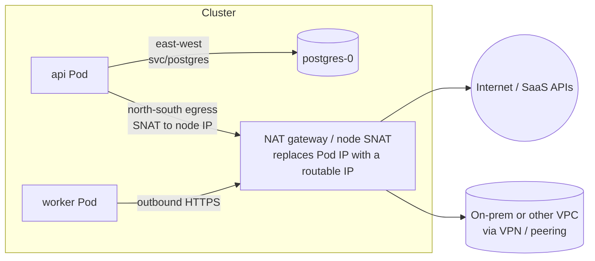
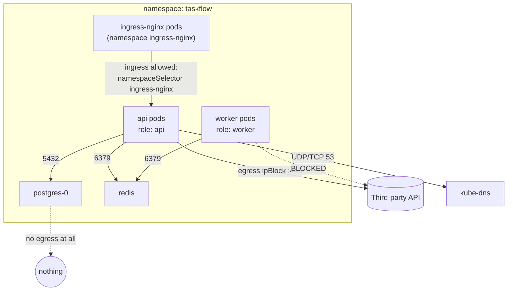

# Concept 06 — Egress (and NetworkPolicy)

> **In one sentence:** Ingress is traffic coming *in*; **egress** is traffic going *out* —
> out of a Pod to other Pods, to a database, to a third-party API, or to the internet — and
> by default it is **completely unrestricted**.

Estimated read: 14 minutes. Prerequisites: [Service](04-service.md), [Ingress](05-ingress.md).

---

## 1. The four traffic directions

People say "network" as if it were one thing. In Kubernetes it is four distinct paths with
four different tools:

| Direction | Path | Controlled by |
|---|---|---|
| **North-south ingress** | outside → cluster | Ingress / Gateway, `Service type: LoadBalancer` |
| **North-south egress** | cluster → outside | NAT gateway / firewall / NetworkPolicy / egress gateway |
| **East-west** | Pod → Pod inside the cluster | Service (DNS + LB), NetworkPolicy |
| **Node-level** | kubelet → Pod (probes, logs), Pod → API server | NetworkPolicy *does* apply here and this surprises people |

Egress is the direction teams forget until a security review asks "which external endpoints
can your Pods reach?" — and the honest answer today is "all of them".



---

## 2. How egress works mechanically

1. The Pod's packet leaves with **source IP = Pod IP** (e.g. `10.244.1.7`), which is not
   routable outside the cluster.
2. It is routed to the Node and **SNAT'd** — the source IP is rewritten to the **Node's IP**
   (or, in cloud clusters, to a **NAT gateway's** static IP).
3. Therefore: *everything in your cluster appears to the outside world to come from the same
   handful of IPs.* This is why a partner asking "which IP should I allowlist?" gets a NAT
   gateway IP, not a Pod IP.
4. Return traffic comes back to that IP and is un-NAT'd.

Consequences:

- **You cannot allowlist a Pod IP externally.** Pod IPs are private, ephemeral, and
  re-created on every reschedule.
- If you need a *stable, dedicated* egress IP (partners who allowlist by IP, or
  PCI-style requirements), you need a **NAT gateway with a static IP**, a **Cilium Egress
  Gateway**, or an **Istio egress gateway** — all of which pin specific Pods to specific
  egress IPs.
- Egress usually **costs money** in clouds (NAT gateway data processing). Reducing chatty
  egress is a real cost lever.

---

## 3. NetworkPolicy: how you actually restrict egress

A **NetworkPolicy** is a Pod-level firewall. Its semantics are the most commonly
misunderstood part of Kubernetes networking, so learn these three rules:

1. **Pods are non-isolated by default.** With no policy selecting a Pod, all ingress and all
   egress is allowed.
2. **A Pod becomes isolated for a direction as soon as any policy selects it *for that
   direction*.** Then only traffic explicitly allowed by *any* policy is permitted.
   Everything else is dropped.
3. **Policies are additive; there are no deny rules.** The allowed set is the **union** of
   all policies that select the Pod. You cannot write "allow all except X" — you write
   "allow exactly these".

Also required: a CNI that **enforces** policies (Calico, Cilium, Antrea, Azure CNI…).
Flannel alone does not; policies will be accepted by the API and silently ignored. Verify
before trusting them.

### The four selectors you can use in a rule

| Selector | Selects |
|---|---|
| `podSelector` | Pods in the **same namespace** as the policy |
| `namespaceSelector` | Pods in namespaces matching a label (combine with `podSelector` for both) |
| `ipBlock` | literal CIDRs — the only way to allow the internet or an external host |
| `ports` (with `protocol`) | limit to TCP/UDP ports, or named ports on the target Pod |

Plus `except` inside `ipBlock` to carve out subnets.

---

## 4. The patterns, in the order you should apply them

### Pattern 1 — Default deny everything in the namespace

Do this first, then add exceptions. Never the other way around.

```yaml
# deny all ingress AND egress for every Pod in this namespace
apiVersion: networking.k8s.io/v1
kind: NetworkPolicy
metadata:
  name: default-deny-all
  namespace: taskflow
spec:
  podSelector: {}            # empty selector = every Pod in the namespace
  policyTypes: [Ingress, Egress]
```

Note: no `ingress`/`egress` blocks means "allow nothing".

### Pattern 2 — Allow DNS (do not skip this)

The moment you deny egress, DNS breaks, and *everything* breaks with confusing
`no such host` errors. DNS is UDP **and** TCP port 53 to `kube-dns` in `kube-system`.

```yaml
apiVersion: networking.k8s.io/v1
kind: NetworkPolicy
metadata:
  name: allow-dns-egress
  namespace: taskflow
spec:
  podSelector: {}
  policyTypes: [Egress]
  egress:
    - to:
        - namespaceSelector:
            matchLabels: { kubernetes.io/metadata.name: kube-system }
          podSelector:
            matchLabels: { k8s-app: kube-dns }
      ports:
        - { protocol: UDP, port: 53 }
        - { protocol: TCP, port: 53 }
```

> Important YAML gotcha: pairing `namespaceSelector` **and** `podSelector` **in the same
> `to` item** means AND (Pods in kube-system labelled kube-dns). Putting them in two
> separate `to` items means OR (any Pod in kube-system, or any kube-dns Pod anywhere). The
> indentation decides your security posture. Get this right.

### Pattern 3 — Allow the app to reach its own database

```yaml
apiVersion: networking.k8s.io/v1
kind: NetworkPolicy
metadata:
  name: api-egress
  namespace: taskflow
spec:
  podSelector:
    matchLabels: { app.kubernetes.io/name: taskflow-api }
  policyTypes: [Egress]
  egress:
    - to:                                        # Postgres
        - podSelector:
            matchLabels: { app.kubernetes.io/name: postgres }
      ports: [{ protocol: TCP, port: 5432 }]
    - to:                                        # Redis
        - podSelector:
            matchLabels: { app.kubernetes.io/name: redis }
      ports: [{ protocol: TCP, port: 6379 }]
```

### Pattern 4 — Allow one specific external API

```yaml
  egress:
    - to:
        - ipBlock:
            cidr: 140.82.121.0/24      # e.g. a vendor's published range
      ports: [{ protocol: TCP, port: 443 }]
```

Two hard limits here, and they are the reason egress control is genuinely awkward:

- **You cannot allow a DNS name.** NetworkPolicy works on IPs. Vendor IPs change. This is
  why Cilium added `toFQDNs` (a Cilium CRD, not core Kubernetes) and why many teams use an
  **HTTP forward proxy** for egress allow-listing by hostname instead.
- **`ipBlock` sees post-SNAT reality inconsistently.** If egress is SNAT'd to the node IP,
  rules referencing external CIDRs behave differently across CNIs. Restrict what you must,
  and prefer "allow to known in-cluster Pods" plus a narrow `ipBlock` for the outside.

### Pattern 5 — Do not break the kubelet's probes

This is the classic self-inflicted outage. **Liveness/readiness probes come from the Node,
not from a Pod.** With `default-deny-all` in place and no ingress rule, kubelet's HTTP probe
to the Pod fails, the Pod is marked NotReady, then it is restarted, and you get
`CrashLoopBackOff` on a perfectly healthy application. Allow the node CIDR for probe ports,
or keep probes on a port exposed by an explicit ingress allowance:

```yaml
  ingress:
    - from:
        - ipBlock:
            cidr: 192.168.49.0/24      # your node/pod CIDR
      ports: [{ protocol: TCP, port: 8080 }]
```

(Different CNIs treat host-network probe traffic differently; test it — this is exactly what
lab step 09 does.)

---

## 5. A complete, realistic egress posture



The story this tells: the worker may talk to Redis but **not** to the internet; Postgres may
talk to nobody; only the ingress controller may reach the API from outside its own
namespace. That is a posture you can defend in a security review, and it is exactly what you
build in [lab step 09](../lab/09-egress-and-network-policies.md).

---

## 6. Beyond NetworkPolicy

| Need | Tool |
|---|---|
| Allow a **domain name** | Cilium `CiliumNetworkPolicy` with `toFQDNs`, or an HTTP forward proxy (`HTTP_PROXY`), or a service mesh with `ServiceEntry` |
| Stable, dedicated **egress IP** | cloud NAT gateway with a static IP, Cilium Egress Gateway, Istio egress gateway |
| **Audit** what actually leaves | VPC flow logs, Cilium Hubble, mesh access logs |
| **Encrypt / mTLS** Pod-to-Pod | service mesh (Istio, Linkerd), which also gives L7 authorization |
| Reach a private database without IP allow-listing | PrivateLink / VPC peering, or a proxy sidecar (Cloud SQL Auth Proxy, RDS Proxy) |

---

## 7. Testing egress (do this instead of guessing)

```powershell
# 1. A throwaway Pod with network tools
kubectl run tmp --rm -it --image=nicolaka/netshoot --restart=Never -n taskflow -- bash

# inside the shell:
nslookup kubernetes.default.svc.cluster.local     # DNS working?
curl -sS -m 5 https://api.github.com/zen          # internet egress working?
nc -zv postgres 5432                              # can I reach the DB?
nc -zv redis 6379
```

`timeout` on a `curl` and a "connection refused" are your two diagnostic signals:

| Result | Meaning |
|---|---|
| `no such host` | DNS is blocked (missing port 53 egress rule) |
| hangs until timeout | silently dropped by a NetworkPolicy |
| `connection refused` | reached something, but nothing listening on that port (wrong port/service) |
| works | allowed — and note that "works" may mean "no policy selected this Pod" |

```powershell
kubectl get networkpolicies -n taskflow
kubectl describe networkpolicy api-egress -n taskflow     # shows what the policy allows
```

---

## 8. Common mistakes

1. **Applying `default-deny-all` and forgetting DNS.** Every app fails with DNS errors.
2. **Breaking kubelet probes** with default-deny ingress (see §4, pattern 5).
3. **Assuming NetworkPolicy is enforced.** Without a supporting CNI it is a no-op.
4. **Thinking policies can deny.** They only allow. To block one host you must allow-list
   everything else.
5. **Scoping to the wrong namespace.** `podSelector` alone only ever matches the policy's own
   namespace. Cross-namespace requires `namespaceSelector`.
6. **Writing one giant policy for everything.** Split by workload so the intent is readable
   and you can see what breaks when you change something.
7. **Expecting FQDN or L7 rules.** Core NetworkPolicy is L3/L4 only.
8. **Assuming egress is free or that Pod IPs are stable externally.** Both are false.
9. **Forgetting that `kube-system` also matters** — a policy that blocks a Pod from reaching
   the API server breaks service accounts, CSI and pod-log access.

---

## 9. Check yourself

1. By default, can a Pod reach the internet? → *Yes. No policy = no restriction.*
2. Two NetworkPolicies select the same Pod, one allowing 5432 and one allowing 443. What is
   allowed? → *both — policies are additive, union of allowances*
3. How do you write "allow everything except evil.example.com"? → *you cannot; NetworkPolicy
   has no deny. You allow-list the rest.*
4. Why do you need a port-53 egress rule? → *DNS goes to kube-dns; block it and name
   resolution dies, which looks like "the whole cluster is broken"*
5. Your Pods break with `CrashLoopBackOff` right after default-deny. First hypothesis? →
   *kubelet probes are being blocked*
6. Where does the outside world see your traffic coming from? → *the NAT gateway / node IP
   after SNAT, never the Pod IP*
7. A vendor asks which IP to allowlist. What do you tell them? → *the stable egress/NAT IP —
   and if you do not have one, that is the reason to add an egress gateway*

---

**Practice it:** [Lab step 09 — Egress & NetworkPolicy](../lab/09-egress-and-network-policies.md) ·
**Next lesson:** [StatefulSet](07-statefulset.md)
