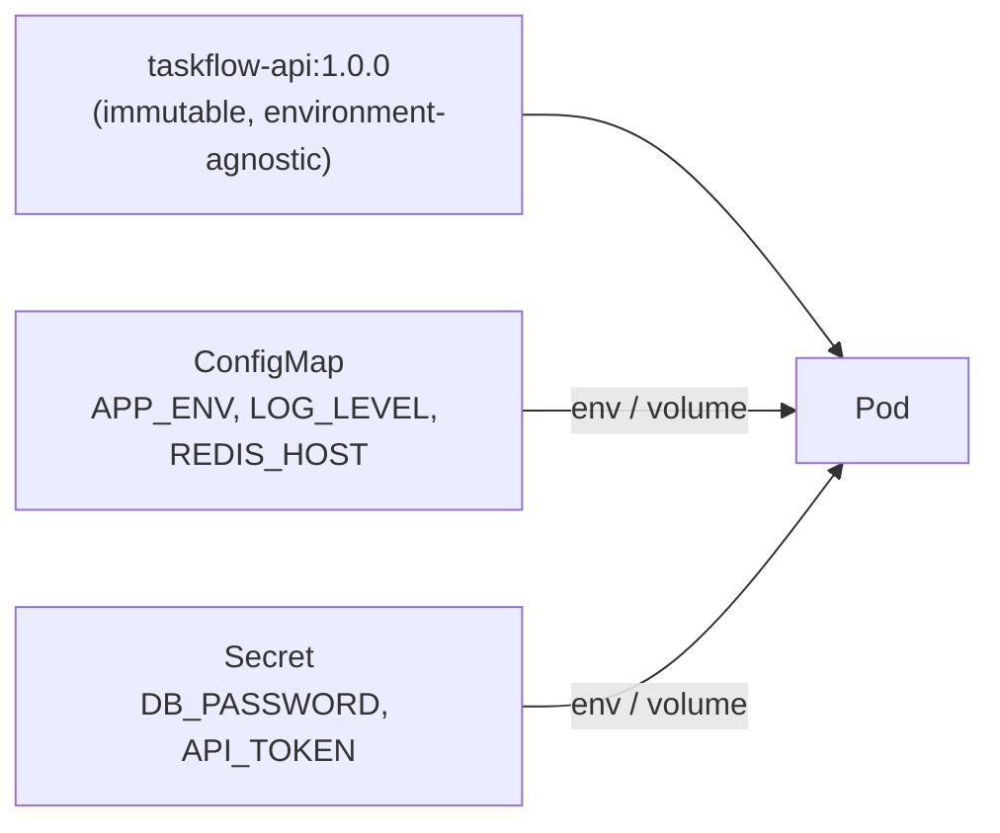
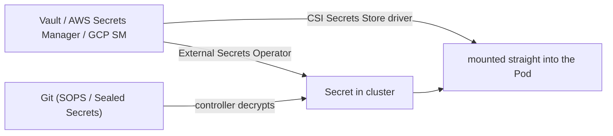

# Concept 09 — ConfigMaps & Secrets

> **In one sentence:** Keep configuration and credentials **out of the image** and inject
> them at runtime — ConfigMaps for non-sensitive config, Secrets for credentials — so the
> same image runs in every environment.

Estimated read: 12 minutes. Prerequisite: [Pod](02-pod.md).

---

## 1. The problem they solve

If your image contains `DB_HOST=prod-db.internal`, then:

- you cannot promote the same image from staging to production,
- rotating a credential needs a rebuild and a redeploy,
- secrets are baked into image layers and pushed to a registry, where anyone who can pull
  can read them forever,
- and every environment needs its own build, so "it works in staging" means nothing.

The twelve-factor answer: **build one immutable image; inject the environment at runtime.**



| | ConfigMap | Secret |
|---|---|---|
| For | non-sensitive config: hosts, ports, flags, log levels, feature toggles | credentials, tokens, TLS keys, SSH keys |
| Stored as | plain text | base64-encoded |
| Size limit | 1 MiB | 1 MiB |
| Encrypted at rest | only if you enable encryption for all data | **only if you enable `EncryptionConfiguration`** — otherwise just base64 |
| Namespaced | yes | yes |

> Say this out loud once: **base64 is not encryption.** `kubectl get secret -o jsonpath` and
> a one-liner decode it. A Secret protects you from *accidental* exposure (it is not printed
> by `kubectl describe pod`, it is kept out of the image), not from an attacker with read
> access to the namespace. Real protection = RBAC + encryption at rest + an external secret
> store.

---

## 2. Creating them

### Imperative (fast, great for learning and for templating)

```powershell
kubectl create configmap taskflow-config -n taskflow `
  --from-literal=APP_ENV=lab `
  --from-literal=LOG_LEVEL=debug

kubectl create configmap nginx-config -n taskflow --from-file=./nginx.conf      # one key per file
kubectl create configmap all-config  -n taskflow --from-file=./config/          # one key per file in dir
kubectl create configmap env-file    -n taskflow --from-env-file=./app.env      # K=V lines

kubectl create secret generic taskflow-secret -n taskflow `
  --from-literal=DB_PASSWORD=labpassword `
  --from-literal=API_TOKEN=dev-token-123
```

To get YAML **without** putting a real value anywhere, use a placeholder:

```powershell
kubectl create secret generic taskflow-secret -n taskflow `
  --from-literal=DB_PASSWORD=CHANGE_ME `
  --dry-run=client -o yaml > 02-config-secret.yaml
```

### Declarative (what goes in Git)

```yaml
apiVersion: v1
kind: ConfigMap
metadata:
  name: taskflow-config
  namespace: taskflow
data:
  APP_ENV: lab
  LOG_LEVEL: debug
  DB_HOST: postgres            # Service name, same namespace -> resolvable
  DB_PORT: "5432"
  DB_NAME: taskflow
  DB_USER: taskflow
  REDIS_HOST: redis
  REDIS_PORT: "6379"
---
apiVersion: v1
kind: Secret
metadata:
  name: taskflow-secret
  namespace: taskflow
type: Opaque
stringData:                    # plain text; API server base64-encodes it for you
  DB_PASSWORD: labpassword
  API_TOKEN: dev-token-123
```

Use **`stringData`** when writing YAML by hand (readable, no manual base64). Use **`data`**
when the value must already be base64 — which is what `kubectl create ... --dry-run=client -o
yaml` and every sealed/encrypted workflow produce.

### Secret types you will meet

| `type` | Contains | Created by |
|---|---|---|
| `Opaque` (default) | arbitrary key/value | you |
| `kubernetes.io/tls` | `tls.crt`, `tls.key` | `kubectl create secret tls`, cert-manager |
| `kubernetes.io/dockerconfigjson` | registry credentials | `kubectl create secret docker-registry` |
| `kubernetes.io/basic-auth` | `username`, `password` | you |
| `kubernetes.io/ssh-auth` | `ssh-privatekey` | you |
| `kubernetes.io/service-account-token` | a ServiceAccount token | the cluster |

---

## 3. Consuming them — two ways, with very different behaviour

### A. As environment variables

```yaml
env:
  - name: DB_PASSWORD
    valueFrom:
      secretKeyRef: { name: taskflow-secret, key: DB_PASSWORD }
  - name: DB_HOST
    valueFrom:
      configMapKeyRef: { name: taskflow-config, key: DB_HOST }
envFrom:                                    # bulk import every key as a variable
  - configMapRef: { name: taskflow-config }
  - secretRef:    { name: taskflow-secret }
  - configMapRef: { name: taskflow-config } # (only one configMapRef per item; use several items)
    prefix: TF_                             # -> TF_APP_ENV, TF_LOG_LEVEL, ...
```

Convenient, and how most apps already read config. Two big limitations:

1. **Changes do not propagate.** Environment variables are fixed when the container starts.
   Change the ConfigMap and running Pods keep the old value — you must restart them
   (`kubectl rollout restart`), or add a checksum annotation to the Pod template.
2. **Secrets in env leak more easily.** They are visible to any process in the container, in
   a crash dump, in `/proc/1/environ`, and inherited by child processes. Prefer volumes for
   credentials.

> Ordering gotcha: `envFrom` and `env` with the same variable name — an explicit `env` entry
> wins, and `envFrom` conflicts are resolved by the list order. Be explicit to avoid
> surprises.

### B. As mounted files (recommended for config files and secrets)

```yaml
spec:
  containers:
    - name: api
      volumeMounts:
        - name: config
          mountPath: /etc/taskflow        # each key becomes a file here
          readOnly: true
        - name: secrets
          mountPath: /etc/taskflow-secrets
          readOnly: true
  volumes:
    - name: config
      configMap: { name: taskflow-config }
    - name: secrets
      secret:
        secretName: taskflow-secret
        defaultMode: 0400                 # owner-read only
        items:                            # optional: pick specific keys/paths
          - { key: DB_PASSWORD, path: db_password }
```

Result inside the container:

```
/etc/taskflow/APP_ENV            -> "lab"
/etc/taskflow/DB_HOST            -> "postgres"
/etc/taskflow-secrets/db_password -> "labpassword"
```

Advantages: file permissions are controllable, values are not in the process environment,
and **mounted ConfigMaps/Secrets are updated in place** when the object changes (kubelet
syncs roughly every minute; the app must re-read the file or watch it).

Three traps:

1. **`subPath` mounts never update.** If you mount a single key with `subPath: app.yaml`,
   the file is frozen at container start. Use a directory mount if you need live updates.
2. **Symlink reality.** kubelet writes the new content to a new directory and swaps the
   `..data` symlink — so apps that hold a file handle open won't see the change. Re-open the
   file, or reload on signal.
3. **`optional: false` (default) means the Pod will not start** if the ConfigMap/Secret is
   missing. Set `optional: true` if the app can boot without it.

### Summary of update semantics

| Delivery | Updates automatically? | Needs a restart? |
|---|---|---|
| `env` / `envFrom` | ❌ never | ✅ yes |
| volume mount (directory) | ✅ ~1 min, app must re-read | ideally, for correctness |
| volume mount with `subPath` | ❌ never | ✅ yes |

---

## 4. `immutable: true`

```yaml
kind: ConfigMap
metadata: { name: taskflow-config-v2 }
immutable: true
```

Benefits: kubelet stops watching it (lower API load on big clusters), and nobody can
accidentally change config in a running environment. Cost: you must create a new object and
update references. Combined with a **new name per revision**, this makes config changes
explicit and git-friendly — a common production pattern (`app-config-2026-09-20`).

---

## 5. Handling secrets properly



| Technique | Notes |
|---|---|
| **Never commit secrets to Git** | Even private repos. Rotate anything that leaks; assume it is compromised |
| **External Secrets Operator / Secrets Store CSI** | The secret lives in Vault/ASM, is synced or mounted into the cluster, and rotation is automated. The modern default |
| **Sealed Secrets / SOPS + age/KMS** | Encrypt in Git; a controller decrypts. Good when you must keep everything in Git |
| **Encryption at rest** | Configure `EncryptionConfiguration` on the API server so etcd (and its backups) are encrypted. Without it, an etcd snapshot contains every Secret in plaintext |
| **RBAC least privilege** | `get/list/watch` on Secrets is effectively *read all credentials in that namespace*. Most workloads need **zero** direct Secret access — they only mount them |
| **Prefer volume mounts over env** | Fewer accidental leaks |
| **Rotate** | Design for it: expect the value to change. Test rotation, don't assume it works |
| **Audit** | Enable audit logging for `secrets` reads; alert on unusual access |

The single most common real-world breach shape in Kubernetes: an over-broad
`ClusterRole` with `get secrets` granted to a ServiceAccount that a workload can reach.

---

## 6. Inspecting and debugging

```powershell
kubectl get configmap taskflow-config -n taskflow -o yaml
kubectl get secret taskflow-secret -n taskflow                    # values are NOT shown
kubectl get secret taskflow-secret -n taskflow -o jsonpath='{.data.DB_PASSWORD}'
kubectl get secret taskflow-secret -n taskflow -o jsonpath='{.data.DB_PASSWORD}' | ForEach-Object { [Text.Encoding]::UTF8.GetString([Convert]::FromBase64String($_)) }   # PowerShell decode
kubectl describe pod taskflow-api-xxx -n taskflow | Select-String -Pattern "Environment" -Context 0,20
kubectl exec -it taskflow-api-xxx -n taskflow -- ls -l /etc/taskflow /etc/taskflow-secrets
kubectl exec -it taskflow-api-xxx -n taskflow -- cat /etc/taskflow/APP_ENV
```

Bash users can shortcut with `kubectl get secret s -o jsonpath='{.data.k}' | base64 -d`.

---

## 7. Common mistakes

1. **Putting credentials in a ConfigMap.** No distinction, no RBAC separation, no encryption
   at rest. Always `Secret`.
2. **Committing a Secret manifest with `stringData` to Git.** Use `--dry-run=client -o yaml`
   with `CHANGE_ME`, or a proper encrypted workflow.
3. **Treating base64 as protection.** It is encoding.
4. **Expecting ConfigMap/Secret changes to restart Pods.** They do not. Restart explicitly,
   or use an immutable, name-versioned ConfigMap referenced by name.
5. **Using `subPath` and expecting live updates.** It never updates.
6. **Hitting the 1 MiB limit.** Do not put a large JSON blob or a certificate bundle in a
   ConfigMap; mount a volume or fetch from a bucket.
7. **Referencing a key that does not exist** → the Pod stays `CreateContainerConfigError`
   and never starts (unless the reference is `optional: true`).
8. **Passing secrets as command-line arguments.** Visible in `ps` output on the Node.
9. **Forgetting `imagePullSecrets`** for a private registry and then debugging
   `ImagePullBackOff` for an hour.
10. **No `defaultMode` on Secret volumes** → files are world-readable inside the container by
    default in some setups. Set `0400`.

---

## 8. Check yourself

1. Difference between a ConfigMap and a Secret? → *intent + base64 + separate RBAC; neither is
   encrypted by default at rest*
2. You updated a ConfigMap consumed via `envFrom`. Do the Pods pick it up? → *No. Restart
   needed.*
3. Same question, but mounted as a volume (no `subPath`)? → *Yes, within roughly a minute, if
   the app re-reads the file*
4. Why avoid `subPath` for config you want to update? → *the file is never refreshed*
5. How do you stop someone from reading Secrets in your namespace? → *RBAC: deny `get/list/
   watch` on `secrets` to that ServiceAccount; also enable encryption at rest and use an
   external store*
6. The Pod is stuck in `CreateContainerConfigError`. First thing to check? → *a missing
   ConfigMap/Secret or a missing/misspelled key*
7. How do you make a config change force a rollout? → *restart the Deployment, or add a
   checksum annotation of the ConfigMap into the Pod template*

---

**Practice it:** [Lab step 02 — Namespace, ConfigMap, Secret](../lab/02-namespace-config-secrets.md) ·
**Next lesson:** [Storage & Volumes](10-storage-and-volumes.md)
