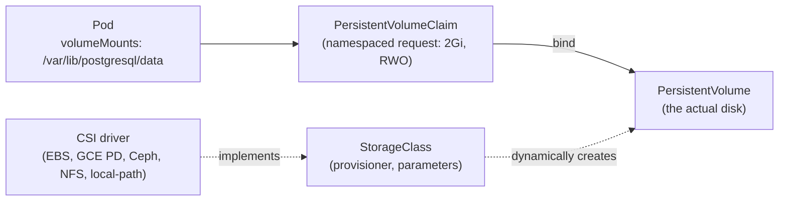

# Concept 10 — Storage & Volumes

> **In one sentence:** A container's filesystem dies with the container; anything that must
> outlive a Pod has to live on a **Volume**, and in a real cluster that means a **PVC** backed
> by a **StorageClass** and a **CSI driver**.

Estimated read: 14 minutes. Prerequisite: [StatefulSet](07-statefulset.md).

---

## 1. The problem: containers are stateless by design

A container's writable layer is deleted when the container is replaced. So:

```powershell
kubectl exec -it postgres-0 -n taskflow -- sh -c "echo hello > /var/lib/postgresql/data/test"
kubectl delete pod postgres-0 -n taskflow     # rescheduled
kubectl exec -it postgres-0 -n taskflow -- cat /var/lib/postgresql/data/test
```

Without a volume: `No such file or directory`. Every restart is a factory reset.

The three-level model that fixes this:



| Object | Scope | Who creates it | Analogy |
|---|---|---|---|
| **Volume** (in a Pod spec) | Pod | you | "mount this here" |
| **PersistentVolumeClaim (PVC)** | Namespaced | you (or a StatefulSet) | "I need 2Gi of ReadWriteOnce storage" |
| **PersistentVolume (PV)** | Cluster | the provisioner (or you, statically) | the actual disk |
| **StorageClass** | Cluster | the platform team | "the kind of disk: SSD, replicated, cheap" |
| **CSI driver** | Cluster | the platform team | the code that talks to the storage backend |

The **indirection is the point**: your manifest says "2Gi, ReadWriteOnce" and nothing about
AWS EBS or Ceph. The same PVC binds to different actual disks on your laptop and in
production.

---

## 2. Volume types you should know

| Type | Lifetime | Use for | Danger |
|---|---|---|---|
| `emptyDir: {}` | Pod | scratch space, cache, sharing files between containers in a Pod | contents vanish with the Pod; **memory-backed if `medium: Memory`** (counts against the memory limit) |
| `configMap` / `secret` | Pod | config files and credentials | see [lesson 09](09-configmaps-and-secrets.md) |
| `downwardAPI` | Pod | expose Pod/Node metadata as files | read-only metadata |
| `projected` | Pod | combine several sources (service account token + config + downwardAPI) | — |
| `hostPath` | **Node** | node agents ([DaemonSet](08-daemonset.md)), reading `/var/log` | Node-local, unmovable, a security risk; **not for application data** |
| `persistentVolumeClaim` | independent of the Pod | databases, uploads, anything durable | — |
| `nfs` / `csi` | external | shared storage (RWX) | needs the driver installed |

```yaml
spec:
  containers:
    - name: app
      volumeMounts:
        - { name: cache, mountPath: /var/cache/app }
        - { name: data,  mountPath: /var/lib/app }
  volumes:
    - name: cache
      emptyDir: {}
    - name: data
      persistentVolumeClaim:
        claimName: app-data
```

Note the separation: `volumes` declare what exists; `volumeMounts` say where it appears in a
specific container. Multiple containers in a Pod can mount the same volume at different paths
— that is the sidecar file-sharing mechanism.

---

## 3. StorageClasses and dynamic provisioning

```powershell
kubectl get storageclass
# NAME                   PROVISIONER                    RECLAIMPOLICY   BINDINGMODE
# standard (default)     k8s.io/minikube-hostpath       Delete          Immediate
# hostpath (default)     docker.io/hostpath             Delete          Immediate   <- Docker Desktop
```

A StorageClass names a **provisioner** plus parameters (disk type, IOPS, encryption,
replication, filesystem). Most classes are marked `(default)` with the annotation
`storageclass.kubernetes.io/is-default-class: "true"`.

**If you omit `storageClassName` in a PVC, the default class is used.** That is exactly why
the lab's PVCs omit it — they work on minikube and Docker Desktop unchanged. In production
you usually name the class explicitly so a cluster-level default change cannot silently
re-provision your database onto a different disk type.

### `volumeBindingMode`

| Mode | Behaviour | Use for |
|---|---|---|
| `Immediate` | the PV is bound as soon as the PVC is created, before any Pod exists | storage with no topology constraints (NFS) |
| `WaitForFirstConsumer` | the PV is created in the same zone as the Pod that consumes it | **cloud block storage (EBS/GCE PD)** — otherwise a Pod can be scheduled in another zone and hang forever |

This is one of the most confusing real-world failures: PVC binds in zone A, Pod is scheduled
in zone B, Pod stays `ContainerCreating` with "volume node affinity conflict". The fix is
`WaitForFirstConsumer`, which most cloud default classes set for you.

### Reclaim policy

| Policy | On PVC delete | Use for |
|---|---|---|
| `Delete` | the underlying disk is deleted | scratch/CI, dynamic workloads |
| `Retain` | the disk is kept, PV becomes `Released`, reclaim manually | databases, anything you might need to recover |

`ReclaimPolicy: Delete` is the default on most dynamic classes. For a database you care
about, **be explicit** — a stray `kubectl delete pvc` should not destroy data.

---

## 4. The lifecycle, end to end

1. You apply a PVC. No PV exists → it goes `Pending`.
2. The StorageClass's provisioner is called. A disk is created and a PV object appears,
   bound to the PVC (`WaitForFirstConsumer` defers this until a Pod references the claim).
3. You create a Pod that references the PVC. The scheduler places the Pod where the volume is
   available.
4. kubelet asks the CSI driver to attach the disk to the Node and mount it into the
   container.
5. The container reads/writes normally. The data is on a real disk, outside the container's
   lifecycle.
6. On Pod deletion, the volume is unmounted but the PV/PVC remain. **Data survives.**
7. Delete the PVC → the PV is deleted or retained according to the reclaim policy.

Access modes (these are a *request*, and the PVC and PV must agree):

| Mode | Abbrev | Meaning |
|---|---|---|
| ReadWriteOnce | **RWO** | read-write by a **single Node** (multiple Pods on that Node are usually fine) |
| ReadOnlyMany | ROX | read-only by many Nodes |
| ReadWriteMany | **RWX** | read-write by many Nodes — needs NFS/CephFS/EFS/Azure Files, **not** plain block storage |
| ReadWriteOncePod | RWOP | read-write by a **single Pod** (strictest; good for databases) |

The classic mistake: assuming `RWO` means "one Pod". It means one **Node** — and most block
storage simply cannot do `RWX`. If your design needs several Pods writing the same files,
you need RWX storage or an object store, not a bigger PVC.

### Growing a volume

```yaml
apiVersion: storage.k8s.io/v1
kind: StorageClass
metadata: { name: standard }
allowVolumeExpansion: true
```

Then edit the PVC's `resources.requests.storage` and it grows (for most CSI drivers, without
restarting the Pod). **Shrinking is impossible.** Expanding also requires driver support.

### Snapshots

`VolumeSnapshotClass` + `VolumeSnapshot` (the `snapshot.storage.k8s.io` CRDs) give
CSI-level point-in-time snapshots, and most backup tools (Velero) build on them. Snapshots
are a storage primitive, not a backup strategy — you still need to test restores.

---

## 5. StatefulSet storage

`volumeClaimTemplates` gives every replica its own PVC:

```yaml
  volumeClaimTemplates:
    - metadata: { name: data }
      spec:
        accessModes: [ReadWriteOnce]
        resources: { requests: { storage: 2Gi } }
```

Produces `data-postgres-0`, `data-postgres-1`, … each bound to that ordinal **forever**.
Delete `postgres-0` and its replacement remounts the exact same disk.

Remember from [lesson 07](07-statefulset.md): deleting a StatefulSet does **not** delete the
PVCs. Cleaning up is your job:

```powershell
kubectl delete statefulset postgres -n taskflow
kubectl get pvc -n taskflow                 # still there — on purpose
kubectl delete pvc -n taskflow -l app.kubernetes.io/name=postgres   # now the data goes
```

---

## 6. Debugging storage

```powershell
kubectl get pvc,pv -A
kubectl describe pvc data-postgres-0 -n taskflow     # Events explain Pending
kubectl get events -n taskflow --field-selector type=Warning
kubectl describe pod postgres-0 -n taskflow | Select-String -Pattern "Volumes" -Context 0,15
```

| Symptom | Cause |
|---|---|
| PVC `Pending`, event "no persistent volumes available" | no default StorageClass, or a `storageClassName` that does not exist |
| PVC `Pending`, event "waiting for first consumer" | normal with `WaitForFirstConsumer`; create the consuming Pod |
| Pod `ContainerCreating` forever, "volume node affinity conflict" | PV in another zone; use `WaitForFirstConsumer` |
| "Multi-Attach error for volume" | an `RWO` volume still attached to another Node; the old Node/Pod has not released it (wait, or force-delete the stale Pod) |
| `permission denied` writing to the mount | `securityContext.fsGroup` missing for a non-root container |
| "data directory is not empty" (Postgres) | volume root has `lost+found`; set `PGDATA` to a subdirectory |
| Data gone after restart | you mounted `emptyDir`, or the container's own filesystem by mistake |

`kubectl describe pvc` Events is the fastest path to the real cause — always start there.

---

## 7. Best practices

1. **Never store data in a container filesystem** or in `emptyDir` if it matters.
2. **Never use `hostPath` for application data.** It pins data to a Node and breaks the
   scheduler's freedom.
3. **Use dynamic provisioning** with a named StorageClass; do not pre-create PVs unless you
   must (on-prem SAN/NFS).
4. **Set `reclaimPolicy: Retain` for databases** and put the PVC in a backup pipeline.
5. **Pick the access mode deliberately.** Need multiple writers → RWX (a *different* disk
   class), not a bigger RWO volume.
6. **Set `fsGroup`/`runAsUser`** so volumes are writable by non-root containers.
7. **Back up and *restore*.** A PVC is a disk, not a backup. Use Velero or the database's own
   tooling (`pg_dump`), and rehearse a restore.
8. **Watch your storage bill.** Orphaned PVCs from deleted StatefulSets are a top-5 source of
   surprise cloud spend.

---

## 8. Check yourself

1. You delete a Pod that mounted a PVC. Is the data gone? → *No — the PVC/PV outlive the Pod.*
2. You delete the PVC. Is the data gone? → *Depends on the reclaim policy; `Delete` (the
   common default) means yes.*
3. What does `RWO` actually restrict? → *one Node, not one Pod*
4. PVC is `Pending` and no PV exists. What do you check? → *`kubectl describe pvc` events;
   default StorageClass exists? provisioner healthy?*
5. Pod is `ContainerCreating` with "volume node affinity conflict". Cause and fix? →
   *PV provisioned in a different zone; use `WaitForFirstConsumer` (or a topology-aware class)*
6. Which volume type is appropriate for a DaemonSet reading `/var/log`? → *`hostPath`,
   read-only*
7. Why does the lab omit `storageClassName`? → *so the cluster's default class is used and the
   manifests work on minikube and Docker Desktop alike*

---

**Practice it:** [Lab step 07 — StatefulSet + Postgres](../lab/07-statefulset-postgres.md) ·
**Next lesson:** [Probes, Resources & Scaling](11-probes-resources-and-scaling.md)
