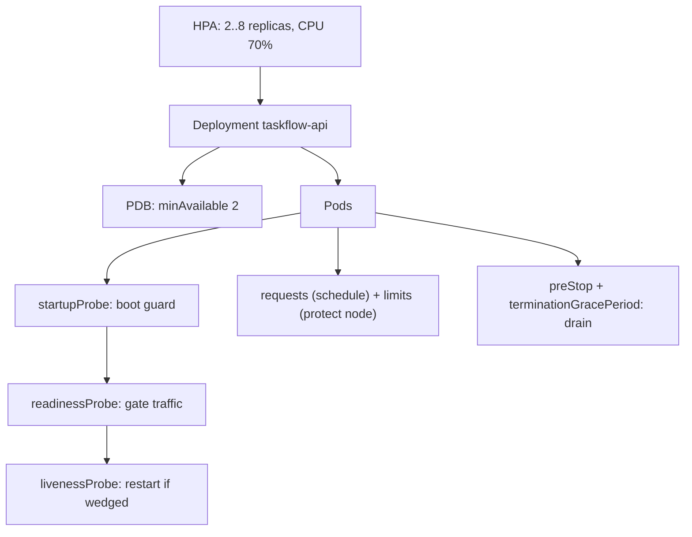

# Concept 11 — Probes, Resources & Scaling

> **In one sentence:** Requests and limits tell Kubernetes how much CPU/memory to reserve and
> cap; probes tell it whether a container is alive and ready for traffic; HPA and PDBs keep
> the workload available as load and maintenance change.

Estimated read: 16 minutes. Prerequisites: [Deployment](03-deployment.md), [Service](04-service.md).

---

## 1. Requests vs limits

```yaml
resources:
  requests:   { cpu: 100m, memory: 128Mi }   # reserved, used for SCHEDULING
  limits:     { cpu: 500m, memory: 256Mi }   # cap, enforced at RUNTIME
```

| | `requests` | `limits` |
|---|---|---|
| Used by | the scheduler (fits the Pod onto a Node with room) | the kernel (cgroups) |
| CPU behaviour | guaranteed share under contention | **throttled** when exceeded — the app gets slower |
| Memory behaviour | used for eviction ordering | **OOMKilled** when exceeded — the container is killed |
| Effect of omitting | Pod may land on a full Node and be starved | unlimited; a memory leak can take down the Node |

The asymmetry is the key insight:

- **CPU is compressible.** Overshooting a CPU limit does not kill you; it throttles you.
  Throttling looks exactly like "the app is randomly slow" and is invisible unless you look
  for it.
- **Memory is incompressible.** Overshooting a memory limit is an immediate `OOMKilled`
  (exit code 137).

### Units

| Unit | Meaning |
|---|---|
| `100m` | 100 millicores = 0.1 CPU. `1000m` = 1 vCPU |
| `1` / `"1"` | 1 vCPU |
| `128Mi` | 128 mebibytes (binary) |
| `128M` | 128 megabytes (decimal) — **use `Mi`/`Gi`**, everyone else does |
| `1Gi` | 1024Mi |

### QoS classes, and why they matter at 3am

| Class | Condition | Evicted |
|---|---|---|
| `Guaranteed` | requests == limits for **all** containers, CPU **and** memory | last |
| `Burstable` | requests set, limits higher or absent | middle |
| `BestEffort` | nothing set anywhere | **first** |

When a Node runs out of memory, the kubelet evicts `BestEffort` Pods first. A production
database should be `Guaranteed`. Setting requests on everything is the single cheapest
reliability improvement you can make to a cluster.

```powershell
kubectl get pod <pod> -n taskflow -o jsonpath='{.status.qosClass}'
kubectl describe node <node> | Select-String -Pattern "Allocated resources" -Context 0,10
kubectl top pods -n taskflow
```

### Practical guidance

| Workload | Guidance |
|---|---|
| CPU | Set requests to the observed steady-state usage. CPU limits are optional — many teams omit them to avoid latency from throttling, relying on requests for fairness. Never omit requests. |
| Memory | **Always set requests and limits.** Memory limits protect the Node. Set the limit ~20–30% above peak observed usage |
| Java | Set `-XX:MaxRAMPercentage` so the JVM heap leaves room for metaspace/threads, or the JVM will be OOMKilled below its own limit |
| Node.js / Python | Default heap settings may exceed the container limit; set `--max-old-space-size` / tune GC |
| Databases | `Guaranteed`, sized from real measurement, with headroom for checkpoints and vacuum |

---

## 2. Probes

Three distinct questions, three distinct probes:

| Probe | Question | On failure | Use for |
|---|---|---|---|
| **`startupProbe`** | has it finished booting? | container is killed and restarted | slow-starting apps; disables liveness/readiness until it passes |
| **`readinessProbe`** | should it receive traffic? | Pod is removed from Service **endpoints** (not restarted) | every production workload |
| **`livenessProbe`** | is it still working, or wedged? | container is **restarted** | deadlock/hang detection |

The mental model: **readiness controls traffic; liveness controls restarts.** Confusing them
causes outages.

- A *readiness* probe that checks the database is dangerous: when the DB is briefly slow,
  every Pod is pulled out of the Service and the outage gets worse for everyone.
- A *liveness* probe that checks a dependency is catastrophic: when the dependency blips,
  every Pod restarts simultaneously, and the dependency is then hammered by cold starts. The
  classic cascading failure.

**Rule: liveness checks only the process itself. Readiness may check dependencies (cautiously).**

Probe mechanisms:

```yaml
      # HTTP — the normal choice for web services
      readinessProbe:
        httpGet: { path: /readyz, port: http, scheme: HTTP }
        initialDelaySeconds: 3     # wait before the first attempt
        periodSeconds: 5           # how often
        timeoutSeconds: 2          # per attempt
        successThreshold: 1        # consecutive successes to be Ready
        failureThreshold: 3        # consecutive failures to act (restart / unready)

      # TCP — when you only need "is the port open"
      livenessProbe:
        tcpSocket: { port: 8080 }

      # exec — when there is no network endpoint to check
      livenessProbe:
        exec: { command: ["sh","-c","pg_isready -U taskflow -d taskflow"] }
```

Timing maths that trips people up: with `initialDelaySeconds: 30` + `periodSeconds: 10` +
`failureThreshold: 3`, a broken container is not restarted for up to ~60 seconds **after**
the initial delay. And on startup, a failure to become ready within the readiness thresholds
means no traffic for at least `periodSeconds × failureThreshold` after it *is* healthy.

Use **`startupProbe`** for legacy apps that need 2 minutes to boot, instead of a giant
`initialDelaySeconds` — it lets readiness and liveness use tight timings once boot completes.

### Graceful shutdown (probes alone are not enough)

```yaml
spec:
  terminationGracePeriodSeconds: 45
  containers:
    - name: api
      lifecycle:
        preStop:
          exec: { command: ["sh","-c","sleep 5"] }   # let endpoints propagate first
```

Order of events on deletion: the Pod is marked `Terminating` and removed from endpoints →
`preStop` runs → `SIGTERM` → app drains → `SIGKILL` after the grace period. The `sleep 5` in
`preStop` exists because endpoint propagation across kube-proxies and load balancers is not
instantaneous; without it, a few requests to a shutting-down Pod are normal during every
deploy.

---

## 3. Horizontal Pod Autoscaler (HPA)

```yaml
apiVersion: autoscaling/v2
kind: HorizontalPodAutoscaler
metadata:
  name: taskflow-api
  namespace: taskflow
spec:
  scaleTargetRef:
    apiVersion: apps/v1
    kind: Deployment
    name: taskflow-api
  minReplicas: 2
  maxReplicas: 8
  metrics:
    - type: Resource
      resource:
        name: cpu
        target: { type: Utilization, averageUtilization: 70 }
  behavior:
    scaleDown:
      stabilizationWindowSeconds: 300     # avoid flapping
      policies:
        - { type: Percent, value: 50, periodSeconds: 60 }
    scaleUp:
      stabilizationWindowSeconds: 0
      policies:
        - { type: Percent, value: 100, periodSeconds: 30 }
```

Key facts:

- **HPA needs `requests` on the containers.** Utilization is computed as a percentage of the
  *request*, so a Deployment with no CPU requests cannot autoscale on CPU at all.
- **HPA needs metrics.** `metrics-server` for CPU/memory; Prometheus Adapter or KEDA for
  custom/external metrics (queue depth, RPS).
- **The HPA controller is in the control plane**; on a local cluster it must be able to read
  metrics or it reports `<unknown>` targets:

```powershell
kubectl get hpa -n taskflow                 # TARGETS must not be <unknown>
kubectl describe hpa taskflow-api -n taskflow
```

- **Scaling out is fast; scaling in is deliberately slow** (`stabilizationWindowSeconds`)
  because removing capacity during a traffic dip is how you cause an outage.
- **You cannot autoscale a database this way.** Horizontal scaling of Postgres means
  replication, not more writers.

Beyond HPA:

| Tool | What it does |
|---|---|
| **VPA** | adjusts requests/limits automatically; cannot be combined with HPA on the same metric |
| **Cluster Autoscaler / Karpenter** | adds/removes **Nodes** when Pods cannot be scheduled. HPA without a node autoscaler just produces `Pending` Pods |
| **KEDA** | scale to zero and scale on external events (queue length, Kafka lag) |

The full chain: **HPA** wants more Pods → Pods are `Pending` → **Cluster Autoscaler** adds a
Node → Pods schedule. Two components, often confused for one.

---

## 4. PodDisruptionBudget (PDB)

An HPA says how many Pods *can* exist. A PDB says how many must **stay** available when
something voluntarily disrupts them: a node drain, a cluster upgrade, a node pool resize.

```yaml
apiVersion: policy/v1
kind: PodDisruptionBudget
metadata:
  name: taskflow-api
  namespace: taskflow
spec:
  minAvailable: 2                # or maxUnavailable: 1
  selector:
    matchLabels: { app.kubernetes.io/name: taskflow-api }
```

- It only affects **voluntary** disruptions (`kubectl drain`, cluster upgrades). It cannot
  protect against a Node crashing or an OOM kill.
- **A PDB can block a node drain indefinitely.** If `minAvailable: 2` but only 2 Pods exist
  and no other Node has room, `kubectl drain` hangs. That is the PDB doing its job — and it
  means you must leave headroom (`maxReplicas` > `minAvailable`, or spare capacity).
- Use `maxUnavailable: 1` when you have several replicas; use `minAvailable` for
  percentage-based guarantees.

---

## 5. Putting it together: a production-safe Deployment



Checklist for a workload you are willing to be paged for:

```
[ ] requests AND limits on every container
[ ] readinessProbe on every container that serves traffic
[ ] livenessProbe that checks only the process itself
[ ] startupProbe if boot takes > 10s
[ ] terminationGracePeriodSeconds + preStop tuned for the app
[ ] replicas >= 2, spread across nodes (topologySpreadConstraints / antiAffinity)
[ ] PodDisruptionBudget matching the replica count
[ ] HPA only when the workload is genuinely stateless and CPU-bound
[ ] metrics-server (or an adapter) installed before relying on HPA
```

---

## 6. Debugging

```powershell
kubectl get pod <pod> -n taskflow -o jsonpath="{.status.containerStatuses[0].restartCount}"
kubectl describe pod <pod> -n taskflow        # "Last State: Terminated, Reason: OOMKilled"
kubectl top pod <pod> -n taskflow --containers
kubectl logs <pod> --previous
kubectl get events -n taskflow --field-selector type=Warning
```

| Symptom | Likely cause |
|---|---|
| `OOMKilled` (exit 137) | memory limit too low, or a leak; check `kubectl top` before the spike |
| `CrashLoopBackOff` with a clean-looking app | liveness probe too aggressive, or a blocked probe endpoint |
| Pod `Running` but no traffic | readiness probe failing — check the endpoint `/readyz` manually |
| Random pod restarts, no logs | liveness probe timing; check `Last State` in `describe` |
| App randomly slow | CPU throttling — compare `limits` to actual usage |
| Pod stays `Pending` | insufficient CPU/memory requests somewhere, or unsatisfiable affinity |
| HPA shows `<unknown>` targets | metrics-server missing/broken, or missing CPU requests |
| Node drain hangs | PDB blocking; check `kubectl get pdb -n taskflow` |

---

## 7. Common mistakes

1. **No requests.** The Pod is `BestEffort` and gets evicted first.
2. **Memory limit set equal to the observed average.** One traffic spike and you are killed;
   leave 20–30% headroom.
3. **No probes at all.** Rolling updates become outages.
4. **Liveness probe that checks the database.** Cascading restart storms.
5. **`initialDelaySeconds: 5` on an app that takes 40s to boot.** Permanent
   `CrashLoopBackOff`. Use a `startupProbe`.
6. **`readinessProbe` identical to `livenessProbe`.** Then readiness never gates anything
   meaningfully.
7. **HPA with no resource requests.** It literally cannot compute a target.
8. **HPA without a node autoscaler.** It scales to `Pending`.
9. **PDB with `minAvailable` equal to `replicas`.** Node drains hang forever; upgrades stall.
10. **Autoscaling a stateful workload.** More writers to one database is not scaling.

---

## 8. Check yourself

1. Which field does the scheduler use, and which does the kernel enforce? → *requests =
   scheduler; limits = kernel/cgroups*
2. `OOMKilled` — which field is implicated? → *the memory limit*
3. You set a CPU limit and the app got slower under load but was never killed. Why? → *CPU
   throttling; the limit is a hard cap per period*
4. Difference between readiness and liveness? → *readiness removes the Pod from Service
   endpoints; liveness restarts the container*
5. Why is a liveness probe that pings the database dangerous? → *a dependency blip restarts
   every replica at once, amplifying the outage*
6. HPA says `TARGETS: <unknown>`. Two causes? → *no CPU requests, or metrics-server not
   available*
7. HPA scaled to `maxReplicas` and Pods are `Pending`. What is missing? → *a cluster
   autoscaler (no Node capacity)*
8. What does a PDB protect against, and what does it not? → *voluntary disruptions (drain,
   upgrade); not crashes or OOM kills*
9. Why add `preStop: sleep 5`? → *endpoint propagation is not instantaneous; it prevents
   502s during shutdown*

---

**Practice it:** [Lab step 10 — Probes, HPA, PDB, rollouts](../lab/10-probes-scaling-and-rollouts.md) ·
**Next lesson:** [Namespaces, RBAC & Quotas](12-namespaces-rbac-and-quotas.md)
