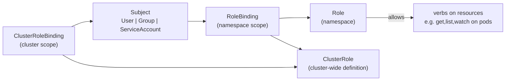

# Concept 12 — Namespaces, RBAC & Quotas

> **In one sentence:** A namespace is a naming and policy scope for objects — **not a network
> or security boundary by itself**. RBAC decides *who may do what*, quotas decide *how much
> they may use*, and NetworkPolicies decide *what may talk to what*.

Estimated read: 14 minutes. Prerequisites: [Service](04-service.md), [Egress](06-egress.md).

---

## 1. What a namespace is (and is not)

```powershell
kubectl create namespace taskflow
kubectl get pods -n taskflow
kubectl get namespaces
```

What you get:

- **Unique names** within the namespace (`taskflow-api` may exist in `dev` and `prod`).
- **A scope for policies**: ResourceQuota, LimitRange, NetworkPolicy, RBAC bindings, Pod
  Security Admission labels.
- **A DNS segment**: `taskflow-api.taskflow.svc.cluster.local`.
- **A unit for `kubectl` scoping** and for `-A` queries.

What you do **not** get:

| Assumption | Reality |
|---|---|
| "Pods in namespace A cannot reach namespace B" | **False.** All Pods can reach all Pods by default. Only a [NetworkPolicy](06-egress.md) changes that. |
| "Namespaces isolate CPU/memory" | **False**, unless you apply a ResourceQuota. |
| "Namespaces are a security boundary" | **False.** They are a *soft* boundary. True isolation needs RBAC + NetworkPolicy + quotas + Pod Security + (ideally) separate clusters for hostile tenants. |
| "Deleting a namespace only deletes my stuff" | It deletes **everything** in it. Be careful with `--all`. |

### Namespaced vs cluster-scoped

Cluster-scoped objects have no namespace and are shared by everyone:

```
Nodes, PersistentVolumes, StorageClasses, ClusterRoles, ClusterRoleBindings,
Namespaces, CustomResourceDefinitions, IngressClasses, PriorityClasses
```

```powershell
kubectl api-resources --namespaced=false     # cluster-scoped kinds
kubectl api-resources --namespaced=true      # namespaced kinds
```

Practical rule: `kubectl get <thing> -A` works only for namespaced kinds.

### Namespaces that always exist

| Namespace | Purpose |
|---|---|
| `default` | where you land if you never specify one — do not run production here |
| `kube-system` | control plane and add-ons (CoreDNS, kube-proxy, CNI, metrics-server) |
| `kube-public` | the `cluster-info` ConfigMap |
| `kube-node-lease` | Node heartbeat Lease objects |
| `ingress-nginx` | the controller (installation-specific, in this lab) |

---

## 2. ResourceQuota and LimitRange

Without them, "one namespace per team" is fiction: a single runaway workload can consume the
whole cluster.

```yaml
apiVersion: v1
kind: ResourceQuota
metadata:
  name: taskflow-quota
  namespace: taskflow
spec:
  hard:
    requests.cpu: "4"
    requests.memory: 8Gi
    limits.cpu: "8"
    limits.memory: 16Gi
    pods: "20"
    persistentvolumeclaims: "4"
    requests.storage: 20Gi
    services.loadbalancers: "1"
---
apiVersion: v1
kind: LimitRange
metadata:
  name: taskflow-limits
  namespace: taskflow
spec:
  limits:
    - type: Container
      default:        { cpu: 500m, memory: 256Mi }   # applied if no limit is specified
      defaultRequest: { cpu: 100m, memory: 128Mi }   # applied if no request is specified
      max:            { cpu: "2",  memory: 2Gi }     # hard ceiling per container
      min:            { cpu: 50m,  memory: 64Mi }
```

| Object | Behaviour |
|---|---|
| **ResourceQuota** | namespace-wide totals. Exceeding it → the API **rejects** the create with a quota error |
| **LimitRange** | per-object defaults/min/max. It *injects* defaults so a Pod without resources gets sane values |

Important interaction: if a namespace has a quota on `requests.cpu`, then **every** Pod
created in it must have a CPU request — either declared or injected by a LimitRange.
Otherwise creation fails with "must specify requests.cpu". This is the #1 surprise when a
team first adds a quota.

```powershell
kubectl describe resourcequota taskflow-quota -n taskflow     # Used vs Hard
kubectl describe limitrange taskflow-limits -n taskflow
```

---

## 3. RBAC in 5 minutes

RBAC answers: **who** (subject) may do **what** (verbs) on **which** things (resources) in
**where** (namespace or cluster).



Four objects, and the pairing is what confuses people:

| Object | Scope | Purpose |
|---|---|---|
| `Role` | namespace | a set of permissions valid in one namespace |
| `ClusterRole` | cluster | a set of permissions usable cluster-wide, **or** reusable by RoleBindings |
| `RoleBinding` | namespace | grants a Role/ClusterRole **within one namespace** |
| `ClusterRoleBinding` | cluster | grants a ClusterRole **everywhere** |

Key insight: **a `RoleBinding` may reference a `ClusterRole`.** That is the normal pattern —
define permissions once as a ClusterRole, then grant them per namespace with RoleBindings.

```yaml
apiVersion: rbac.authorization.k8s.io/v1
kind: Role
metadata:
  name: taskflow-reader
  namespace: taskflow
rules:
  - apiGroups: [""]                       # core group
    resources: ["pods", "services", "configmaps"]
    verbs: ["get", "list", "watch"]
  - apiGroups: ["apps"]
    resources: ["deployments"]
    verbs: ["get", "list", "watch"]
---
apiVersion: rbac.authorization.k8s.io/v1
kind: RoleBinding
metadata:
  name: taskflow-reader
  namespace: taskflow
subjects:
  - kind: ServiceAccount
    name: taskflow-api
    namespace: taskflow
  - kind: Group
    name: developers
    apiGroup: rbac.authorization.k8s.io
roleRef:
  kind: Role
  name: taskflow-reader
  apiGroup: rbac.authorization.k8s.io
```

Verbs you will use: `get`, `list`, `watch`, `create`, `update`, `patch`, `delete`,
`deletecollection`. Plus subresources: `pods/log`, `pods/exec`, `pods/portforward`.

### ServiceAccounts

Each Pod runs as a ServiceAccount (default: `default` in its namespace) and can receive a
token to call the API server.

```yaml
apiVersion: v1
kind: ServiceAccount
metadata:
  name: taskflow-api
  namespace: taskflow
automountServiceAccountToken: false      # no API access -> no token mounted
```

**Most application Pods need no API access at all.** Leaving `automountServiceAccountToken`
at its default `true` hands every Pod a token for the (usually overly broad) `default`
ServiceAccount. Set it to `false` unless the app genuinely talks to the API — this removes an
entire class of privilege-escalation path.

Modern tokens are **bound tokens** with an expiry, projected into the Pod, not long-lived
Secrets. If you need a long-lived token you are probably doing something wrong.

### Testing permissions without guessing

```powershell
kubectl auth can-i get pods -n taskflow
kubectl auth can-i create deployments --as=system:serviceaccount:taskflow:taskflow-api -n taskflow
kubectl auth can-i --list -n taskflow
kubectl auth can-i delete secrets --as=system:serviceaccount:taskflow:default -n taskflow
```

`--as=` impersonation is the right way to verify a binding actually grants what you think
before you ship it.

### Pod Security Admission

Namespace labels enforce Pod hardening standards:

```yaml
apiVersion: v1
kind: Namespace
metadata:
  name: taskflow
  labels:
    pod-security.kubernetes.io/enforce: restricted
    pod-security.kubernetes.io/enforce-version: latest
    pod-security.kubernetes.io/warn: restricted
```

| Level | Meaning |
|---|---|
| `privileged` | unrestricted — needed by node agents (CNI/CSI DaemonSets) that need `hostPath`, `hostNetwork` or `privileged` containers |
| `baseline` | forbids the known privilege-escalation paths: privileged containers, `hostNetwork`/`hostPID`/`hostIPC`, **`hostPath` volumes**, added capabilities, unconfined seccomp. The right default for application namespaces |
| `restricted` | baseline, plus non-root, dropped capabilities, seccomp profile required, and only a safe set of volume types |

Two consequences that catch people out:

1. **`hostPath` is forbidden at `baseline`, not just `restricted`.** A DaemonSet that reads
   `/var/log` therefore cannot live in a `baseline` namespace — and there is no per-Pod
   exemption, so privileged infrastructure gets its own namespace (in this lab,
   `node-agents`).
2. **`warn` and `audit` can be stricter than `enforce`.** Setting `enforce: baseline` with
   `warn: restricted` gets you a hard block on the dangerous things while still printing
   everything a fully hardened namespace would reject. That combination is a good default
   while you migrate.

This is why the lab's Pods set `runAsNonRoot`, `runAsUser` and `seccompProfile` — they are
written to survive a `restricted` namespace.

---

## 4. A namespace layout that works

| Approach | Example namespaces | Best for |
|---|---|---|
| By environment | `dev`, `staging`, `prod` | small teams |
| By application | `taskflow`, `payments` | platform teams, clear ownership |
| By team | `team-a`, `team-b` | many teams, quota per team |
| **By both** | `taskflow-prod`, `taskflow-dev` | the common production answer |

Then, in each namespace: a ResourceQuota, a LimitRange, a default-deny NetworkPolicy, a set
of Roles bound to teams, and Pod Security labels. Repeatable via a templating tool
(Kustomize/Helm) so the *shape* of a namespace is identical everywhere.

---

## 5. Common mistakes

1. **Treating namespaces as a security boundary.** Two tenants in one cluster can reach each
   other's Pods unless you add NetworkPolicy.
2. **Forgetting `-n`.** You apply to the wrong namespace and then debug why nothing changed.
3. **Running production in `default`.** Makes RBAC and quotas impossible to scope.
4. **Binding `cluster-admin` to a ServiceAccount** because it "was easier". That is root on
   the cluster for any Pod using it.
5. **Leaving `automountServiceAccountToken: true`** on apps that do not need API access.
6. **`ClusterRoleBinding` when a `RoleBinding` would do.** Over-grants cluster-wide.
7. **Adding a quota without a LimitRange**, breaking every Pod create in that namespace.
8. **`kubectl delete namespace` on shared namespaces.** Everything inside goes with it.
9. **Not labelling namespaces** (`kubernetes.io/metadata.name` is automatic, but your own
   labels for `namespaceSelector` are not) — NetworkPolicies silently match nothing.
10. **Ignoring `kubectl auth can-i --as=`** and shipping permissions you never verified.

---

## 6. Check yourself

1. Are namespaces a security boundary? → *No; they are a scope for policy. Isolation needs
   RBAC + NetworkPolicy + quotas + Pod Security.*
2. Can a Pod in `dev` reach a Service in `prod`? → *Yes, by FQDN
   `svc.prod.svc.cluster.local`, unless a NetworkPolicy blocks it.*
3. `Role` vs `ClusterRole` vs the bindings? → *Role/ClusterRole define permissions; bindings
   grant them. RoleBinding grants within one namespace (and may reference a ClusterRole);
   ClusterRoleBinding grants cluster-wide.*
4. What does `kubectl auth can-i --as=system:serviceaccount:ns:sa get pods` do? → *simulates
   the service account's permissions*
5. Namespace has a CPU quota; the Pod has no CPU request. What happens? → *creation is
   rejected unless a LimitRange injects a default*
6. Why set `automountServiceAccountToken: false`? → *removes an unnecessary API credential
   from the Pod, shrinking the attack surface*
7. Which object enforces non-root containers? → *Pod Security Admission (namespace label) —
   `restricted` level*

---

**Practice it:** [Lab step 02 — Namespace, ConfigMap, Secret](../lab/02-namespace-config-secrets.md) ·
**Next lesson:** [Jobs & CronJobs](13-jobs-and-cronjobs.md)
