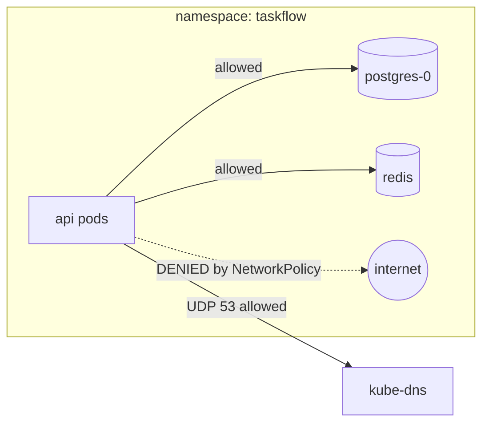
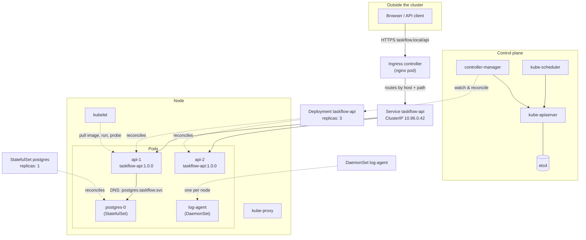

# Getting started 03 — The mental model (read this first)

This is the whole course in one page. Every other document is a zoom-in on one of the
boxes below.

Read it as the story of *how a normal application ends up running in production*.

---

## Step 0 — You have an application

A process that listens on a port. It might be a Go binary, a Node server, a Java jar.
It needs CPU, memory, a way to read config, and a place to write logs.

**Kubernetes does not care what it is.** It only cares that it can be packaged as a
**container image**.

## Step 1 — Package it as a container image

```dockerfile
FROM python:3.12-slim
WORKDIR /app
COPY requirements.txt .
RUN pip install --no-cache-dir -r requirements.txt
COPY app.py .
USER 1000                       # never run as root
EXPOSE 8080
ENTRYPOINT ["gunicorn", "-b", "0.0.0.0:8080", "app:app"]
```

```powershell
docker build -t taskflow-api:1.0.0 labs/app
```

An image is a **read-only template**: immutable, tagged, reproducible. The same image runs
on your laptop and in production. Nothing about the environment is baked in — no
hard-coded DB host, no secret in the image. Config arrives at runtime
([ConfigMaps/Secrets](../concepts/09-configmaps-and-secrets.md)).

> The lab's app lives in [`labs/app/`](../../labs/app/). Read it once; it is small.

## Step 2 — A container is not enough, so wrap it in a Pod

A **container** is just an isolated process, and something must supervise it: restart it,
give it a network namespace, mount its volumes, schedule it onto a machine.

Kubernetes delegates that to the **Pod** — the smallest deployable unit. A Pod is a group
of one or more containers that are always scheduled **together** on the same Node, share a
network namespace (so they reach each other on `localhost`) and can share volumes.

```yaml
apiVersion: v1
kind: Pod
metadata:
  name: sample-pod
spec:
  containers:
    - name: sample-container
      image: nginx:latest
      ports:
        - containerPort: 80
```

That is your existing `sample.yaml`. It works — but it is a dead end, for three reasons:

1. **A bare Pod is not supervised by anything.** Delete it and it is gone forever.
   Node dies, Pod dies. Nobody brings it back.
2. **A Pod is ephemeral and gets a new IP every time.** IP `10.244.1.7` today,
   `10.244.2.11` after a restart. Nothing can depend on that address.
3. **It is not scalable.** You cannot say "give me three of these".

So a bare Pod is a teaching device and a debugging tool. Everything real is behind a
controller.

→ [Lesson 02 — Pod](../concepts/02-pod.md)

## Step 3 — Wrap the Pod in a Deployment so it is scheduled and kept alive

You declare *the desired state*: "I want 3 copies of `taskflow-api:1.0.0`, each with these
resources and probes."

```yaml
apiVersion: apps/v1
kind: Deployment
metadata:
  name: taskflow-api
spec:
  replicas: 3
  selector:
    matchLabels: { app.kubernetes.io/name: taskflow-api }
  template:                      # <-- this is the Pod blueprint
    metadata:
      labels: { app.kubernetes.io/name: taskflow-api }
    spec:
      containers:
        - name: api
          image: taskflow-api:1.0.0
```

Now Kubernetes does real work for you:

- The **scheduler** looks for a Node with enough free CPU/memory, considering
  affinity/taints, and assigns each Pod to one.
- The **kubelet** on that Node pulls the image and starts the containers.
- The **Deployment controller** continuously compares *desired* (3) with *actual*
  (however many are alive) and closes the gap: it recreates Pods that crash or are
  deleted, and it stops creating them if you scale down.
- You get **rolling updates** and **rollback** for free. And, because Pods all come from
  the same template, you get **horizontal scale** by changing one number.

**Key sentence:** a Deployment does not run Pods, it *manages ReplicaSets*, which manage
Pods. The Pod is always the thing that actually runs.

→ [Lesson 03 — Deployment](../concepts/03-deployment.md)

## Step 4 — Because Pods are ephemeral, put a Service in front of them

You now have three healthy Pods with three different IPs, and those IPs change every time
something restarts. The old Pod is gone before its replacement exists.

A **Service** solves exactly this. It is a stable virtual IP + DNS name that load-balances
across **all Pods matching a label selector**.

```
taskflow-api.taskflow.svc.cluster.local   ->  10.96.0.42  ->  { 10.244.1.7, 10.244.2.11, 10.244.3.9 }
      (never changes)                          (stable VIP)        (come and go freely)
```

- The client only ever knows the Service name. It never sees a Pod IP.
- Kubernetes maintains an **Endpoints/EndpointSlice** list of currently-*ready* Pods
  behind the Service. Pods that fail their readiness probe are removed automatically —
  that is how you get zero-downtime deploys without a load balancer config.
- DNS inside the cluster resolves the Service name, so your app talks to
  `postgres.taskflow.svc.cluster.local` and does not care which Pod is behind it.

Service types escalate in exposure:

| Type | Reachable from | Lab use |
|---|---|---|
| `ClusterIP` (default) | inside the cluster only | Postgres, Redis — internal only |
| `NodePort` | `<any-node-ip>:30000-32767` | quick manual testing |
| `LoadBalancer` | a cloud load balancer | real clusters on a cloud provider |
| `ExternalName` | DNS alias to an outside host | pointing at a managed database |

→ [Lesson 04 — Service](../concepts/04-service.md)

## Step 5 — In production, do not let the outside world reach your Service directly

If you expose the API as `NodePort` or `LoadBalancer`, then **every** Service you expose
needs its own IP, its own certificate, its own firewall rule. You have no single place to
put TLS, rate limiting, auth or routing rules. That does not scale operationally.

Instead, the whole cluster gets **one front door**: an **Ingress**.

```yaml
apiVersion: networking.k8s.io/v1
kind: Ingress
metadata:
  name: taskflow
  annotations:
    nginx.ingress.kubernetes.io/rewrite-target: /
spec:
  ingressClassName: nginx
  rules:
    - host: taskflow.local
      http:
        paths:
          - path: /api
            pathType: Prefix
            backend:
              service:
                name: taskflow-api
                port: { number: 80 }
```

- An **Ingress** is only a *routing rule* (a declaration).
- An **Ingress controller** (here: ingress-nginx) is the *actual proxy Pod* that reads
  those rules and forwards traffic. **No controller = no effect.**
- Routing is by **hostname and path**, so one IP and one certificate serve many services:
  `taskflow.local/api` → API Service, `taskflow.local/` → frontend, `admin.taskflow.local`
  → admin Service.
- TLS termination, redirects, rate limits, auth and canary weights all live here, in one
  place. This is the difference between "exposed" and "production".

So the north-south path is:

```
Internet → Ingress controller → Service (stable VIP) → Pod (ephemeral) → container
```

→ [Lesson 05 — Ingress](../concepts/05-ingress.md)

## Step 6 — Traffic also leaves the cluster: that is Egress

Not all traffic is inbound. Your API calls a payment provider; your worker polls a queue;
your Pods talk to Postgres. That outbound direction is **Egress**.

By default **all egress is allowed and no egress is restricted**. In production you lock
it down with **NetworkPolicies**: deny everything by default, then allow exactly what is
needed (DNS, the database, one external API host).



The classic mistake: you apply default-deny egress, everything breaks, and the cause is
that you forgot to allow **DNS**. That exact failure is reproduced deliberately in
[lab step 09](../lab/09-egress-and-network-policies.md).

→ [Lesson 06 — Egress](../concepts/06-egress.md)

## Step 7 — Some workloads are not interchangeable, so they use different controllers

So far every replica has been identical and stateless. Real systems have three exceptions,
and Kubernetes has a dedicated controller for each:

| Need | Controller | Why not a Deployment |
|---|---|---|
| Stable identity + own persistent disk (Postgres, Kafka, Elasticsearch) | **StatefulSet** | Deployment Pods are anonymous and interchangeable; they cannot own a specific PVC or a stable DNS name |
| Exactly one Pod on **every** Node (log shipper, node exporter, CNI agent) | **DaemonSet** | A Deployment's replicas are spread arbitrarily; you cannot say "one per Node" |
| Work that must **run to completion** (migration, batch job, nightly cleanup) | **Job / CronJob** | A Deployment is designed to *restart* forever — the opposite of "run once and finish" |

**StatefulSet** gives you, per replica: an ordinal name (`postgres-0`, `postgres-1`), a
stable DNS name via a *headless* Service (`postgres-0.postgres.taskflow.svc.cluster.local`),
its own `volumeClaimTemplate` PVC that follows the Pod across reschedules, and strictly
ordered create/delete (0 first, then 1; teardown in reverse).

**DaemonSet** runs one Pod per Node, automatically including Nodes added later, and gets
`spec.nodeName`, the node's IP and node name injected as environment variables.

→ [Lesson 07 — StatefulSet](../concepts/07-statefulset.md) ·
[Lesson 08 — DaemonSet](../concepts/08-daemonset.md) ·
[Lesson 13 — Jobs & CronJobs](../concepts/13-jobs-and-cronjobs.md)

---

## The complete picture



## The four ideas underneath all of it

1. **Declarative desired state.** You write `spec` (what you want). Kubernetes writes
   `status` (what is). Controllers loop forever trying to make them equal. You never issue
   "start a container" commands.
2. **Everything is addressed by labels.** Services, Deployments, NetworkPolicies and HPAs
   find Pods through **label selectors**, never by name or IP. Labels are the wiring of the
   system.
3. **The Pod is ephemeral; nothing may depend on its identity.** Stability is added from
   the outside: Deployments for availability, Services for addressing, StatefulSets when
   identity is genuinely required, PVCs for data.
4. **Separation of concerns.** The image is immutable; config comes from ConfigMaps and
   Secrets; the network is described by Services, Ingress and NetworkPolicies; health is
   described by probes; capacity by requests/limits. Each concern has its own object, so
   each can be changed independently.

---

## Order to read next

1. [What is Kubernetes](../concepts/01-what-is-kubernetes.md) — the machinery that makes
   the above possible: control plane, Nodes, kubelet, etcd, scheduler.
2. Then follow the [concept lessons](../README.md#3-learning-path) in order, doing the
   matching [lab step](../lab/00-scenario-and-requirements.md) after each one.
3. When something is unclear, read
   [the request lifecycle](../architecture/01-request-lifecycle.md) — it traces one HTTP
   request through every box above, byte by byte.
