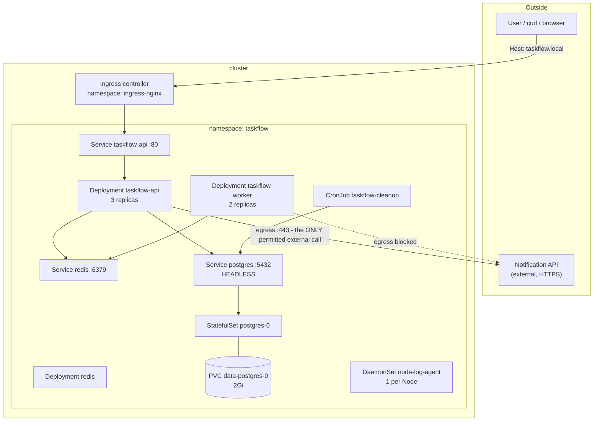

# Lab 00 — The scenario, and how a requirement becomes Kubernetes

**Goal:** turn a plain-English product requirement into a concrete list of
Kubernetes objects, and understand *why* each object is the right answer. No
cluster needed yet.

Read together with the [mental model](../getting-started/03-mental-model.md). This
step is the "design review" you would have before writing any YAML.

---

## 1. The product

> **TaskFlow** is an internal task-management API. Teams create tasks, mark them
> complete, and get notified. There is a small web frontend, a REST API, a worker
> that sends notifications, and a nightly cleanup that purges old completed tasks.

It is deliberately small. What makes it useful for this lab is that it is **not
only a stateless web app** — it has a database, a queue, a background worker, a
scheduled job, node-level agents and third-party calls, which is where every real
Kubernetes decision actually comes from.

---

## 2. The requirements, in the customer's words

### Functional

| # | Requirement |
|---|---|
| F1 | Users can create, list and complete tasks over HTTP. |
| F2 | The service is reachable at `http://taskflow.local` (and `api.taskflow.local`). |
| F3 | Task data must survive restarts, redeploys and node failures. |
| F4 | Completing a task enqueues a notification, processed asynchronously. |
| F5 | Completed tasks older than 7 days are purged nightly. |
| F6 | The API can call one external service over HTTPS (the notification provider). |
| F7 | The database must be reachable only by the application, never from outside the cluster. |
| F8 | Operators need node-level logs/metrics collection on every machine. |

### Non-functional

| # | Requirement |
|---|---|
| N1 | 99.9% availability during business hours. |
| N2 | Deploys must not cause downtime. |
| N3 | A single node failure must not take the service down. |
| N4 | Traffic will grow 5x at peak; capacity must follow demand without manual work. |
| N5 | A cluster upgrade or node drain must not remove all replicas at once. |
| N6 | "It works on my laptop" must stop being a category of bug. |
| N7 | Least privilege: credentials scoped, no unnecessary cluster access. |
| N8 | Config/database credentials must change without rebuilding the image. |

---

## 3. The translation — requirement by requirement

This is the part that matters. Every row is a decision you will have to make for
real, and every "why" is a thing an interviewer will ask about.

| Requirement | Kubernetes object | Why this object |
|---|---|---|
| F1 HTTP API | **Deployment + Service** | Stateless, horizontally scalable, interchangeable replicas. A Deployment heals and scales it; a Service gives it a stable address. |
| F2 Public hostname | **Ingress** (+ controller) | One IP, one certificate, routing by host and path. Avoids one `LoadBalancer` per Service. |
| F3 Durable data | **StatefulSet + `volumeClaimTemplates` (PVC)** | A PVC outlives the Pod; the ordinal binding means `postgres-0` always remounts `data-postgres-0`. |
| F4 Async work | **Deployment (worker) + ClusterIP Service (Redis)** | The worker must run *forever*, not once — that rules out a Job. The queue is internal-only, so ClusterIP. |
| F5 Nightly purge | **CronJob → Job → Pod** | Work with a schedule that must *finish*. A Deployment would restart it forever. |
| F6 External HTTPS call | **Egress NetworkPolicy** | Egress is unrestricted by default. Restricting it to one host on port 443 is a security requirement, not a nicety. |
| F7 DB not public | **Headless ClusterIP Service (no Ingress), NetworkPolicy** | The database has no Ingress and no NodePort, so it has no external path. `default-deny` makes that explicit rather than accidental. |
| F8 Node-level agents | **DaemonSet** | Exactly one Pod per Node, automatically including Nodes added later. Not expressible with `replicas`. |
| N1/N3 Availability | `replicas: 3` + `podAntiAffinity` | Replicas survive a Pod dying; anti-affinity spreads them so one Node dying does not take all of them. |
| N2 No-downtime deploy | `RollingUpdate`, `maxUnavailable: 0`, **readinessProbe** | The probe is what makes the strategy meaningful. Without it, "ready" only means "the process started". |
| N4 Follow demand | **HorizontalPodAutoscaler** | Scales replicas on a signal. (Real systems scale the worker on queue depth via KEDA — CPU is often the wrong signal.) |
| N5 Safe maintenance | **PodDisruptionBudget** | Caps how many Pods can be voluntarily evicted during a drain/upgrade. |
| N6 Same everywhere | **Immutable image + ConfigMap/Secret** | One image, environment injected at runtime. No per-environment builds. |
| N7 Least privilege | **ServiceAccount, ResourceQuota, LimitRange, Pod Security** | Identity, blast radius, sane defaults, and a floor on container hardening. |
| N8 Config without rebuild | **ConfigMap + Secret** | Values injected as env vars or mounted files; the image never changes. |

### Requirements we consciously say NO to

Being explicit about scope is part of designing:

| Not doing | Why not | What it would be |
|---|---|---|
| TLS on the Ingress | No DNS/certificate authority in a local lab | cert-manager + Let's Encrypt, or a supplied cert |
| Postgres HA (replicas > 1, failover) | A StatefulSet gives identity, not replication. Half-configured replication is worse than none | CloudNativePG / Zalando operator, or a managed database |
| Service mesh / mTLS | Adds a sidecar to every Pod; the concepts are learned later | Istio or Linkerd |
| GitOps | Out of scope for the concepts; you apply files by hand on purpose | Argo CD or Flux |
| Autoscaling the *Nodes* | Impossible on a single-node local cluster | Cluster Autoscaler / Karpenter |
| A real log pipeline | The DaemonSet is a stand-in for the *pattern* | Fluent Bit / Vector → Elasticsearch / Loki |

---

## 4. The target design



---

## 5. Conventions you will follow for the whole lab

### Namespace

`taskflow` — one namespace per application, with a quota, a LimitRange, a
ServiceAccount and a Pod Security level. Created in step 02.

### Labels

Every object carries these. They are not decoration: **Services, Deployments,
NetworkPolicies and the HPA all find their targets through selectors.**

| Label | Values | Used by |
|---|---|---|
| `app.kubernetes.io/name` | `taskflow-api`, `taskflow-worker`, `redis`, `postgres`, `node-log-agent` … | every selector in the lab |
| `app.kubernetes.io/component` | `backend`, `worker`, `database`, `cache`, `agent`, `batch` | NetworkPolicy (`allow-probes-from-node` matches on this) |
| `app.kubernetes.io/part-of` | `taskflow` | grouping queries, `kubectl get all -l` |
| `app.kubernetes.io/version` | `1.0.0`, `1.1.0` | rollout identification |

These are the standard [recommended labels](https://kubernetes.io/docs/concepts/overview/working-with-objects/common-labels/),
which is why every tool understands them.

### Names

`taskflow-api`, `taskflow-worker`, `taskflow-migrate`, `taskflow-cleanup`. Pod
names are generated by the controller (`taskflow-api-<rs-hash>-<pod-hash>`), which
is correct — do not name Pods by hand.

### Images

`taskflow-api:1.0.0`, later `taskflow-api:1.1.0`. Never `latest`, and always
`imagePullPolicy: IfNotPresent` for locally built images.

---

## 6. Definition of done

By the end of the lab, all of these must be true. This is the acceptance test for
your own work.

```
[ ] kubectl get deploy -n taskflow      -> taskflow-api 3/3, taskflow-worker 2/2, redis 1/1
[ ] kubectl get statefulset -n taskflow -> postgres 1/1
[ ] kubectl get daemonset -n node-agents   -> node-log-agent DESIRED == number of Nodes
[ ] kubectl get pvc -n taskflow         -> data-postgres-0 Bound
[ ] kubectl get ingress -n taskflow     -> an ADDRESS, and rules for both hosts
[ ] kubectl get hpa -n taskflow         -> TARGETS is a number, not <unknown>
[ ] kubectl get pdb -n taskflow         -> ALLOWED DISRUPTIONS >= 1
[ ] curl -H "Host: taskflow.local" http://<ingress-ip>/api/tasks   -> a task list
[ ] POST a task, then GET /api/queue    -> depth returns to 0 (the worker consumed it)
[ ] kubectl get networkpolicies -n taskflow -> 9 policies (includes default-deny)
[ ] kubectl get jobs -n taskflow        -> taskflow-migrate Complete
[ ] Logs of a cleanup Job run show a deletion count
[ ] kubectl rollout undo works after a bad image tag
[ ] Delete a Pod; the Deployment replaces it and the Service keeps serving
[ ] Delete postgres-0; it comes back with the SAME PVC and the data is intact
```

If you can do all of that without consulting the docs, you are ready for
[the interview questions](../reference/interview-questions.md).

---

## 7. Common mistakes to avoid from day one

1. **Applying manifests into the wrong namespace.** Set the default namespace and
   check `kubectl config current-context` before big changes.
2. **Deploying before reading.** These files are commented teaching material; the
   comments contain the reasons the fields exist.
3. **Using `latest`.** You lose rollback and reproducibility, and `Always` pull
   policies will silently change what is running.
4. **Skipping `describe` when something is broken.** The Events section names the
   cause. `kubectl get pods` never does.
5. **Assuming the lab is broken when a dependency is missing.** The API is built to
   degrade gracefully: before step 07, `/api/tasks` returns a `503` that explains
   exactly what is missing. That is the system working as designed.
6. **Testing through `port-forward` and thinking you tested the Service.** It
   bypasses load balancing. Test from a Pod.

---

**Next:** [Lab 01 — Bootstrap the cluster](01-bootstrap-cluster-and-tools.md) →
