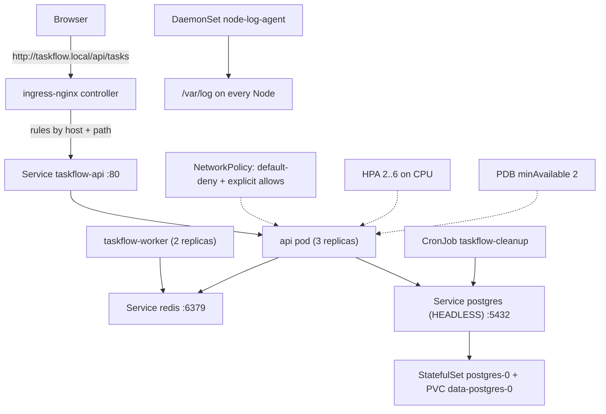

# Track B — the guided lab

You will build **TaskFlow**, a small but realistic production-shaped application,
one Kubernetes concept at a time. Every step ends with something you can point at
in a cluster and a set of small experiments that make the concept real.

Roughly 1–2 hours per step. Do them in order — each step assumes the previous one.

---

## How each step is structured

```
Goal              what you will have working at the end
Before you start  the concept lesson to read first, and the prerequisites
Steps             numbered commands with the output you should expect
Verify            how to prove it actually works (not just that it "applied")
Break it          deliberately break it and observe the failure - this is where learning happens
Exercises         extra things to try on your own
Troubleshooting   the specific failure you are most likely to hit
Clean up          what to remove (or not remove) before moving on
```

**Do the "Break it" sections.** Applying YAML teaches you syntax. Breaking
something and diagnosing it teaches you Kubernetes.

---

## Step index

| # | Step | Concept lesson | Manifests | Time |
|---|---|---|---|---|
| 00 | [Scenario & requirements](00-scenario-and-requirements.md) | — | — | 20 min |
| 01 | [Bootstrap the cluster](01-bootstrap-cluster-and-tools.md) | [What is Kubernetes](../concepts/01-what-is-kubernetes.md) | — | 30 min |
| 02 | [Namespace, ConfigMap, Secret](02-namespace-config-secrets.md) | [ConfigMaps & Secrets](../concepts/09-configmaps-and-secrets.md), [Namespaces/RBAC/Quotas](../concepts/12-namespaces-rbac-and-quotas.md) | `labs/01-*`, `labs/02-*` | 45 min |
| 03 | [Your first Pod](03-pods-first-contact.md) | [Pod](../concepts/02-pod.md) | `labs/03-pod.yaml` | 45 min |
| 04 | [Build the image, deploy it](04-deployment-and-image.md) | [Deployment](../concepts/03-deployment.md) | `labs/04-deployment.yaml` | 90 min |
| 05 | [Service](05-service.md) | [Service](../concepts/04-service.md) | `labs/05-service.yaml` | 60 min |
| 06 | [Ingress](06-ingress.md) | [Ingress](../concepts/05-ingress.md) | `labs/06-ingress.yaml` | 60 min |
| 07 | [StatefulSet + Postgres](07-statefulset-postgres.md) | [StatefulSet](../concepts/07-statefulset.md), [Storage](../concepts/10-storage-and-volumes.md) | `labs/07-postgres.yaml` | 90 min |
| 08 | [DaemonSet](08-daemonset.md) | [DaemonSet](../concepts/08-daemonset.md) | `labs/08-daemonset.yaml` | 45 min |
| 09 | [Egress & NetworkPolicy](09-egress-and-network-policies.md) | [Egress](../concepts/06-egress.md) | `labs/09-networkpolicy.yaml` | 90 min |
| 10 | [Probes, HPA, PDB, rollouts](10-probes-scaling-and-rollouts.md) | [Probes/Resources/Scaling](../concepts/11-probes-resources-and-scaling.md) | `labs/10-hpa-pdb.yaml` | 75 min |
| 11 | [Debugging like an operator](11-operations-troubleshooting.md) | [Architecture: on apply](../architecture/02-what-happens-on-apply.md) | `labs/11-broken-workloads.yaml` | 90 min |
| 12 | [Job & CronJob](12-job-and-cronjob.md) | [Jobs & CronJobs](../concepts/13-jobs-and-cronjobs.md) | `labs/12-job-cronjob.yaml` | 60 min |
| 13 | [Cleanup & review](13-cleanup-and-review.md) | — | — | 45 min |

---

## Target architecture (what you end up with)



---

## Ground rules

1. **Namespace `taskflow` for everything.** Set it as your default so you stop
   typing `-n taskflow`:
   `kubectl config set-context --current --namespace=taskflow`
2. **Read the YAML in `labs/` as you go.** The files are commented like teaching
   notes. `kubectl apply` without reading is just copy-paste.
3. **Never use `:latest`.** You will build `1.0.0` and later `1.1.0` so that
   rollouts and rollbacks have something to do.
4. **Keep a scratch file** for the commands you find most useful. By step 13 you
   should have your own cheatsheet, and it will be better than the one here.
5. **When something breaks, do not delete it.** Diagnose it. `describe` → events →
   logs → endpoints, in that order.
6. **Type `curl.exe`, not `curl`.** In Windows PowerShell 5.1, `curl` is an alias for
   `Invoke-WebRequest`, which takes completely different flags — `-H`, `-s`, `-X` and
   `-d` will all fail confusingly. `curl.exe` is the real thing. (Inside a container,
   plain `curl` is correct.)

All commands in this lab are written for **Windows PowerShell 5.1**, matching the
machine this lab was built and verified on. Bash equivalents are noted where the syntax
genuinely differs.
